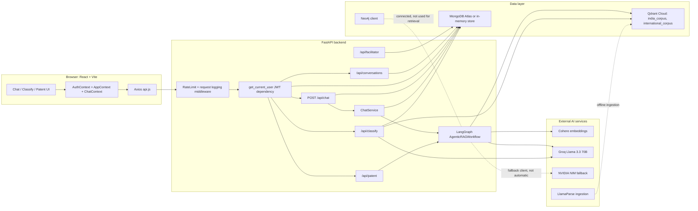
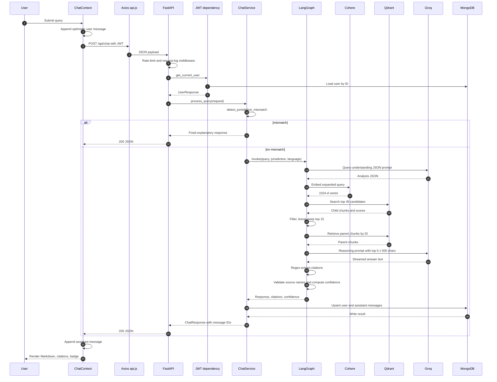
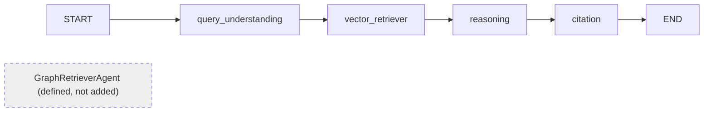
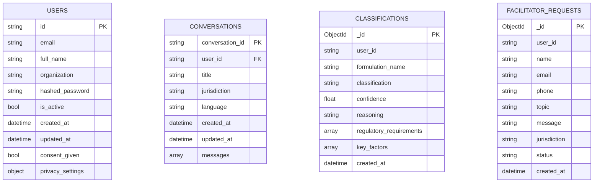

# AyurPedia — Project-Specific Interview Preparation

This document is a reference for software engineering, AI/ML, and agentic-AI placement interviews. It is grounded in the repository's **working tree as inspected on 2026-10-17**, not in the README's aspirational claims.

**Status labels used throughout**

| Label | Meaning |
|---|---|
| **Implemented** | Present and wired into the running path. |
| **Partial** | Code exists but is not fully wired, is shadowed, or has verified gaps. |
| **Not implemented** | No implementation exists in the repository. |
| **Unverified** | Cannot be confirmed from the repo (no tests, saved metrics, or deployment artifacts). |
| **Code-traced** | Behavior inferred by reading source; not confirmed by a runtime test. |

Two important caveats:

1. The working tree contains uncommitted modifications, so this document may differ from `HEAD`.
2. The README contains claims that the code does not substantiate. Where a claim is unsupported, it is called out explicitly.

---

## 1. Project Overview

**AyurPedia** is a full-stack, multilingual legal and regulatory assistant for Ayurvedic intellectual property. A user asks a natural-language question; the backend retrieves statutory and treaty text from a vector database, generates an answer with a large language model, extracts citations from the generated text, assigns a heuristic confidence label, and stores the question/answer pair in MongoDB. Two companion tools classify herbal formulations into regulatory categories and produce a Section 3(p) patent-novelty assessment.

### Problem

Ayurvedic practitioners, AYUSH startups, and herbal manufacturers must navigate several overlapping regimes:

- The Patents Act, 1970, especially Section 3(p) (traditional knowledge and mere aggregation of known properties).
- The Biological Diversity Act, 2002 and National Biodiversity Authority access/benefit-sharing requirements.
- FSSAI Ayurveda-Aahar Regulations, 2022.
- The Traditional Knowledge Digital Library (TKDL).
- International instruments: WIPO GRATK Treaty 2024, TRIPS, and the Nagoya Protocol.

The information is fragmented, largely English-language, and easy to misread. A wrong conclusion can lead to a rejected filing, an invalid claim, or a benefit-sharing dispute.

### Intended users

- Ayurvedic practitioners and researchers.
- AYUSH startups and herbal-product manufacturers.
- Pharmaceutical companies developing botanical products.
- IP lawyers and regulatory consultants.
- Traditional-knowledge holders and cultivators.

### Capability status

| Capability | Status | Where it lives |
|---|---|---|
| Legal Q&A with retrieval-grounded answers | **Implemented** | `POST /api/chat` → `ChatService` → LangGraph workflow |
| Source citations with confidence label | **Partial** | Regex extraction and source-name validation; see Section 8 |
| Conversation persistence and reload | **Implemented** | MongoDB `conversations` collection; `GET /api/conversations` |
| Delete a user/assistant message pair | **Implemented, with a client-side ID mismatch bug** | `DELETE /api/conversations/{id}/messages/{message_id}` |
| JWT authentication | **Implemented** | `/api/auth/register`, `/login`, `/me`, `/refresh` |
| Jurisdiction toggle (India / International / Both) | **Implemented** | Two Qdrant collections and a keyword-based mismatch guard |
| Multilingual output | **Partial** | LLM is told the target language; frontend translates some fixed UI strings |
| Formulation classification | **Implemented, with a UI/API field mismatch** | `POST /api/classify` |
| Patent novelty and Section 3(p) analysis | **Implemented** | `POST /api/patent/novelty-check` |
| Human facilitator escalation | **Partial** | Ticket is stored; no notification or case-management workflow |
| Neo4j knowledge graph | **Partial / effectively unused** | Client connects at startup; `GraphRetrieverAgent` is not added to the graph; `/graph` route is disabled |
| Streaming responses to the browser | **Not implemented** | Internal `llm.stream()` exists but the HTTP response is a single JSON body |
| Automated tests | **Not implemented** | No `pytest`/`jest`/`vitest` test files |
| Saved RAG evaluation results | **Not implemented** | An evaluation script exists, but no results are committed |
| Deployment configuration | **Not implemented** | README shows examples; no Dockerfile, compose file, or platform config exists |

### 30-second explanation

> AyurPedia is a FastAPI + React application that answers Ayurvedic IPR questions using retrieval-augmented generation. It stores six legal documents in Qdrant as hierarchical parent/child chunks, embeds them with Cohere, retrieves relevant text, and asks a Groq-hosted Llama 3.3 70B model to answer with citations. The backend extracts those citations, computes a heuristic confidence score, and persists the exchange to MongoDB. It also classifies formulations and checks Section 3(p) patent novelty.

### 60-second explanation

> The core problem is that Ayurvedic IPR spans the Patents Act, the Biological Diversity Act, FSSAI regulations, and international treaties such as WIPO GRATK and Nagoya. AyurPedia makes this navigable through three tools. The chat tool retrieves from two Qdrant collections, one per jurisdiction, using hierarchical chunking: child chunks of about 400 characters are matched, then expanded to parent chunks of about 2,000 characters for context. A four-node LangGraph pipeline performs query analysis, retrieval, reasoning, and citation validation. Answers are saved with `parent_message_id` links so a question and its answer can be deleted together. The classification tool uses the same retrieval stack plus an LLM prompt to place a formulation into one of seven regulatory categories. The patent tool combines an ingredient-retrieval heuristic with LLM analysis of the process, combination, and Section 3(p) compliance. The system is a hackathon prototype: authentication and persistence work, but there is no automated test suite, no committed evaluation result, and no production deployment hardening.

### Two-minute explanation

> AyurPedia is an end-to-end legal-tech prototype. On the frontend, React with Context API manages authentication, language, jurisdiction, and chat state. Axios attaches a JWT to every API call. On the backend, FastAPI initializes MongoDB, an optional Neo4j client, Qdrant, Cohere embeddings, and a Groq LLM during its lifespan. A chat request goes through rate limiting and a JWT dependency, then into `ChatService`. A keyword heuristic first rejects queries that clearly belong to the other jurisdiction. The query enters a LangGraph `StateGraph` with four nodes wired in a straight line: query understanding, vector retrieval, reasoning, and citation processing. Query understanding asks the LLM for JSON analysis, but that analysis is not consumed downstream. Retrieval expands the query with a domain dictionary, embeds it with Cohere, searches 45 candidates in Qdrant, filters and boosts them heuristically, returns the top 15, and expands children to parents. Reasoning formats the top five documents at 500 characters each into a prompt and streams the LLM response internally. Citation processing extracts `[Source: ...]` tags with regular expressions, validates that the source name appears in the retrieved metadata, and labels confidence High/Medium/Low from the average retrieval score and citation count. `ChatService` then saves both messages to MongoDB with generated UUIDs and a parent link. The frontend renders Markdown, citation cards, and a confidence badge. Classification and patent analysis reuse the retriever and LLM, but are separate endpoints. The honest engineering assessment is that the retrieval pipeline is real, the persistence and ownership checks are real, and the "agentic" label is generous: there is no conditional routing, tool selection, reflection, or retry loop.

### What is technically interesting

- Hierarchical retrieval (child match → parent context) instead of flat chunks.
- Citation extraction and validation as a post-processing stage around a free-form LLM.
- A stateful workflow abstraction (LangGraph) around a currently linear pipeline.
- Two-collection jurisdiction isolation plus a deterministic keyword guard.
- Embedded conversation documents with ownership-scoped upserts and paired message deletion.
- Visible tension between synchronous AI libraries and asynchronous FastAPI handlers.

---

## 2. Problem Statement and Motivation

### Why keyword search is insufficient

- **Vocabulary mismatch.** A user asks about "biopiracy"; the statute says "access and benefit-sharing" or "unauthorized use of traditional knowledge." A user asks "can I patent my grandmother's kadha?"; the relevant phrase is "Section 3(p)" and "mere aggregation of known properties."
- **No semantic equivalence.** Exact matching misses paraphrases, synonyms, and multilingual formulations.
- **No ranking or calibration.** A keyword hit list does not tell the user which provision is authoritative or how strongly it applies.
- **Statutory structure matters.** Section numbers, provisos, and cross-references are part of the answer; isolated term matches lose that structure.

### Why a generic chatbot is insufficient

- **Hallucinated authority.** A general model can invent section numbers, article numbers, or treaty provisions.
- **No grounding signal.** It cannot say which retrieved document supports a claim because nothing was retrieved.
- **No jurisdiction control.** Indian and international frameworks can be blended without warning.
- **No persistence or ownership.** There is no conversation history tied to an authenticated user.
- **No audit trail.** A legal-tech product needs to show what it relied on.

### What AyurPedia attempts

- Retrieve from a curated corpus before answering.
- Force the model to cite retrieved sources.
- Post-process citations into structured cards.
- Give the user a coarse confidence label.
- Persist the exchange for later review.
- Keep India and International corpora separate.

### Boundaries of reliable conclusions

These boundaries follow directly from the code:

1. **The corpus is six PDFs.** India: Patents Act 1970, Biological Diversity Act 2002, FSSAI Ayurveda-Aahar Regulations 2022. International: WIPO GRATK Treaty 2024, TRIPS Agreement, Nagoya Protocol. The system cannot reliably answer questions about statutes outside this corpus.
2. **Retrieval is dense-only in production.** `Retriever` does vector search plus dictionary query expansion and heuristic score boosts. The `HybridRetriever` with Cohere reranking is used only by the evaluation script, not by `main.py`.
3. **The answer is probabilistic.** The primary model is `llama-3.3-70b-versatile` at temperature 0.4. The same query can produce different wording.
4. **Citations are not semantically verified.** The citation stage checks whether the cited source name is a substring of a retrieved source name. It does not verify that the cited section exists in that source or that the sentence is supported by the cited text.
5. **Confidence is heuristic.** It is computed from average retrieval score and citation count, not calibrated against human judgments.
6. **No conversation memory is sent to the model.** Follow-up questions such as "What about Nepal?" have no prior-turn context.
7. **No measured improvement is established.** The README's metrics table (92% citation accuracy, 88% relevance, 85% classification F1, 2.5 s response time, 96% jurisdiction accuracy) has no supporting artifact in the repository. Treat those numbers as **unverified claims**, not results.
8. **It is not legal advice.** The application itself displays that disclaimer.

### What would be needed to claim reliability

- A held-out gold question set with reference answers and source spans.
- Retrieval metrics: precision@k, recall@k, MRR, nDCG.
- Citation precision/recall against source spans, not just source-name matches.
- Human legal review with inter-annotator agreement.
- Calibration analysis of the confidence label.
- An abstention policy when retrieval is weak.
- Regression tests for the pipeline and for persistence.

---

## 3. Features and User Workflows

### 3.1 Standard chat workflow

**What the user does:** types a question in the chat input and presses Enter or the send button. The input supports voice dictation through the browser Web Speech API.

**Frontend path**

1. `MessageInput` calls `sendMessage` from `ChatContext`.
2. `ChatContext` rejects empty text and blocks while `isLoading` is true.
3. If there is no `conversationId`, it calls `createConversation(jurisdiction, language)`.
4. It appends an optimistic user message with a client-generated UUID.
5. It calls `POST /api/chat` through Axios.

**Backend path**

6. The custom rate-limit middleware checks the client IP.
7. The request-logging middleware logs the method, path, and up to 500 characters of the request body.
8. CORS middleware runs with `allow_origins=["*"]` and `allow_credentials=True`.
9. The route dependency `get_current_user` decodes the JWT, verifies `type == "access"`, and loads the user from MongoDB.
10. `chat()` sets `request.user_id` and creates a conversation document if `conversation_id` is absent.
11. `ChatService.process_query` runs the jurisdiction mismatch heuristic.
12. `AgenticRAGWorkflow.invoke` runs the four-node graph synchronously.
13. `ChatService.format_response` converts the result into `ChatResponse`, maps confidence to a numeric score, and adds the disclaimer.
14. `persist_conversation` writes the user and assistant messages with server-generated UUIDs and a `parent_message_id`.
15. The endpoint returns one JSON `ChatResponse`.

**Response path**

16. `ChatContext` appends the assistant message using the backend's `assistant_message_id`.
17. `MessageList` renders Markdown, citations, the confidence badge, and the disclaimer.
18. `CitationCard` renders each citation with a copy button and an always-on "Verified" badge.

**Important verified behavior**

- The welcome message is generated on the frontend and translated through `translationApi`; it is **not stored** in MongoDB.
- The jurisdiction mismatch response is returned **before** the persistence block, so it is not saved to history.
- No prior conversation turns are included in the LLM prompt.
- The HTTP response is not streamed. `ReasoningAgent` calls `llm.stream()` internally, but the tokens are buffered into a string.

### 3.2 Conversation lifecycle

| Action | UI trigger | Frontend code | Backend code | Storage effect | Verified notes |
|---|---|---|---|---|---|
| Create conversation | First message or Clear Chat | `createConversation` in `chatApi.js` | `POST /api/conversations` in `conversations.py` | Inserts a document | The frontend sends a JSON body, but this route reads **query parameters**. The body is ignored, so the stored jurisdiction/language are the defaults `India`/`en`. |
| Save a Q&A pair | After a successful chat response | `sendMessage` | `ChatService.persist_conversation` → `MongoDBManager.save_message` | `$push` two messages | The user message gets a server UUID; the frontend keeps its client UUID locally. |
| Load most recent conversation | Login, jurisdiction change, language change, `welcomeMessage` change | Effect in `ChatContext` | `GET /api/conversations`, `GET /api/conversations/{id}` | Read | Picks the first conversation whose `jurisdiction` matches the current selection. If none exists, creates a new conversation. |
| Switch to a conversation | No wired UI | `loadConversation` exists | `GET /api/conversations/{id}` | Read | `ConversationSidebar.jsx` is not imported anywhere. |
| Delete a message pair | Trash icon on user messages | `deleteMessage` | `DELETE /api/conversations/{id}/messages/{message_id}` | `$pull` by message `id` | In the same session, the frontend sends its optimistic client UUID, which is not in MongoDB. The request 404s until the page is reloaded. |
| Clear chat | Clear Chat button / Ctrl+Shift+C | `clearMessages` | `POST /api/conversations` | Creates a new conversation; old one is retained | History is not deleted. |
| Export chat | Export button / Ctrl+E | `exportConversation` | None | None | Downloads a JSON file from current React state. |
| Delete conversation | No UI | None | `DELETE /api/conversations/{conversation_id}` from `conversations_auth.py` | Deletes the document | Route exists but is not reachable from the UI. |
| Logout | Header menu | `logout` in `AuthContext` | None | None | Clears tokens and user; ChatContext resets to the welcome message. |

### 3.3 Formulation classification

**Workflow**

1. The user enters a formulation description through the classification wizard or quick-paste input.
2. `classifyApi.classifyFormulation` sends `{ formulation_description }` to `POST /api/classify`.
3. The endpoint validates that either `formulation_name` or `formulation_description` is present.
4. It creates a **new** `QdrantDB` and `Retriever` per request.
5. `ai_classify_formulation` retrieves India-jurisdiction context for the formulation, takes the top three documents, truncates each to 200 characters, and builds a prompt.
6. The LLM is asked to return JSON with `classification`, `confidence`, `reasoning`, `regulatory_requirements`, and `key_factors`.
7. The endpoint parses the first `{...}` block with a regex, normalizes unknown categories to `Unknown`, and saves the record.
8. The response is a `ClassificationResponse`.

**Categories:** Classical, Proprietary, Ayurveda-Aahar, Cosmetic, Phytopharmaceutical, Nutraceutical, Unknown.

**Verified UI/API mismatch**

- Backend response fields: `classification`, `confidence`, `reasoning`, `regulatory_requirements`, `key_factors`, `id`, `ai_generated`.
- Frontend `ClassificationResult` destructures: `category`, `confidence`, `relevant_laws`, `description`, `jurisdiction`.
- Because the names do not match, the UI falls back to `category = "Proprietary"`, `confidence = 0.85`, `relevant_laws = []`, a generic description, and `jurisdiction = "India"`.
- "Use in Legal Chat" then sends a follow-up using that fallback category.

**Other verified behavior**

- The endpoint has **no authentication dependency** and saves with `user_id=None`.
- `GET /api/classify` is also unauthenticated and can list all stored classifications.
- The LLM and retrieval calls are synchronous inside an async handler.
- The full request is logged at INFO, including formulation details.

### 3.4 Patent novelty checker

**Workflow**

1. The user submits formulation name, ingredients, process, intended use, optional novelty claim, and jurisdiction.
2. The frontend splits the ingredients string on commas and calls `POST /api/patent/novelty-check`.
3. `PatentNoveltyAgent.analyze_novelty` runs six steps:
   - Search traditional-knowledge context for up to three ingredients and for the formulation name.
   - Analyze ingredient novelty.
   - Analyze process novelty.
   - Analyze combination novelty.
   - Compute the weighted overall score.
   - Identify prior art and run Section 3(p) analysis.
4. The response contains a 0–100 novelty score, risk level, per-component breakdown, prior-art references, Section 3(p) status, and confidence.

**Scoring**

- Weights: Ingredients 0.4, Process 0.3, Combination 0.3.
- Risk: score ≥ 70 → Low; ≥ 40 → Medium; otherwise High.
- Ingredient novelty is a retrieval-hit heuristic: `(1 - ingredients_with_retrieved_context / total_ingredients) * 100`. It is not a semantic assessment of whether the ingredient is traditional.
- Process and combination scores come from LLM JSON outputs with a fallback of 50.
- Section 3(p) status is an LLM JSON output normalized to one of Patentable, Partially Patentable, Not Patentable, Uncertain.
- Confidence starts at 0.7, adds 0.1 if traditional context was found, adds 0.1 if prior art was found, and caps at 0.95.

**Verified behavior**

- No authentication dependency.
- Synchronous LLM and retrieval calls in an async handler.
- Ingredient analysis depends on retrieval returning a document for the ingredient; the reference case handling is case-sensitive and fragile.
- Prior-art `relevance` comes from retrieval scores, not a legal relevance judgment.

### 3.5 Jurisdiction selection

- The frontend offers India, International, and All Jurisdictions.
- India queries `india_corpus`; International queries `international_corpus`; Both queries both and merges.
- Before retrieval, `detect_jurisdiction_mismatch` scans the query for keywords from the other jurisdiction. If India is selected and an international keyword appears, the user is told to switch; the reverse is also true. `Both` bypasses the check.
- The keyword lists are hardcoded in `chat_service.py` and are not exhaustive. A query can be misclassified, and the response is a fixed instruction rather than a retrieved answer.

### 3.6 Language selection

- The frontend exposes 12 languages: English, Hindi, Sanskrit, Marathi, Bengali, Tamil, Telugu, Kannada, Malayalam, Gujarati, Punjabi, Odia.
- The active LangGraph prompts map only 10 codes; Sanskrit and Odia are absent from the agent language maps and fall back to the raw code string.
- Chat responses are multilingual only because the prompt tells the model to answer in the target language.
- The welcome message is translated on the frontend via a dictionary/optional Bhashini integration.
- There is no backend translation or language detection in the chat path.

### 3.7 Facilitator escalation

- `Disclaimer` and `ClassificationResult` open `FacilitatorModal`.
- The modal posts to `POST /api/facilitator/request`.
- The backend stores the ticket in `facilitator_requests`.
- There is no authentication, no email, no assignment, and no status workflow beyond the default `"Pending"`.
- The modal shows a success screen even when the request fails (catch block sets `isSubmitted` and shows a success toast).
- The modal maps the institution field to `phone`, and sends no organization field.

---

## 4. Technology Stack

| Technology | Role in this project | Where | Why it fits | Alternatives and trade-offs |
|---|---|---|---|---|
| Python 3.10 | Backend runtime | `backend/` | Ecosystem for AI, FastAPI, LangChain, Qdrant | 3.11/3.12 would be faster; the repo contains CPython 3.10 bytecode artifacts. |
| FastAPI | HTTP API, dependency injection, lifespan | `backend/main.py`, `backend/app/api/` | Async, Pydantic validation, automatic OpenAPI docs | Flask/Django are simpler or more batteries-included but less ergonomic for async + typed models. |
| Uvicorn | ASGI server | `backend/main.py` | Standard FastAPI server | Gunicorn + Uvicorn workers for production; current code uses one process with `reload=True` in `__main__`. |
| Pydantic v2 | Request/response validation | `backend/app/models/` | Declarative schemas, serialization | Some legacy `.dict()` usage remains. |
| LangGraph | Four-node `StateGraph` orchestration | `backend/app/graph/agents.py` | Typed state, checkpointing, explicit pipeline | A plain function chain would be simpler; LangGraph adds overhead without conditional routing here. |
| LangChain Core/LangGraph messages | `HumanMessage`, `AIMessage`, reducers | agents | Standard message abstraction | Direct SDK calls would reduce dependency surface. |
| `langchain-groq` + `ChatGroq` | Primary LLM client | `backend/app/core/llm.py` | Low-latency hosted inference | Model choice affects legal accuracy and citation behavior. |
| `langchain-openai` + `ChatOpenAI` | NVIDIA NIM fallback client | `llm.py` | OpenAI-compatible endpoint | Fallback is not automatically used on runtime rate limits; only when Groq cannot be constructed. |
| Groq `llama-3.3-70b-versatile` | Answer generation, JSON analysis | `config.py` | Strong open-weight model at low latency | No fine-tuning; temperature 0.4; max 4,096 output tokens. |
| NVIDIA NIM `deepseek-ai/deepseek-v4-flash-0731` | Configured fallback | `config.py`, `llm.py` | Alternate provider | Runtime switching is incomplete; direct NIM client is initialized but unused by the main path. |
| Cohere `embed-english-v3.0` | 1,024-dimensional embeddings | `backend/app/ingestion/embedder.py` | Strong English retrieval, simple API | English-only model in a multilingual product; no multilingual embedding model. |
| Qdrant Cloud | Vector store | `backend/app/core/database.py` | Payload filtering, parent/child storage, cosine search | pgvector or Weaviate are alternatives; Qdrant's payload indexes suit this schema. |
| LlamaParse | PDF → Markdown extraction | `backend/app/ingestion/parser.py` | Handles complex legal PDFs | Adds an external dependency and cost; OCR quality affects downstream retrieval. |
| MongoDB Atlas + `motor` | Users, conversations, classifications, tickets | `backend/app/core/mongodb.py` | Flexible document model for embedded messages | PostgreSQL with normalized messages would make analytical queries easier; embedded arrays have a 16 MB document limit. |
| Neo4j driver | Optional graph client | `backend/app/core/neo4j.py` | Cypher and relationship traversal | Not used for retrieval; the graph is not populated. |
| `python-jose` | JWT signing/verification (HS256) | `backend/app/core/auth.py` | Simple symmetric tokens | Asymmetric keys or an identity provider would be stronger for multi-service deployments. |
| `bcrypt` | Password hashing | `core/auth.py` | Standard adaptive hashing | Argon2 is a modern alternative; code truncates passwords to bcrypt's 72-byte limit. |
| `slowapi` | Limiter object import | `core/rate_limit.py` | Familiar API | The actual enforcement is a custom in-memory middleware; `slowapi` is not doing the work. |
| Sentry SDK | Error tracking | `core/sentry.py`, `main.py` | Stack traces, 10% transaction sampling | Optional; disabled without `SENTRY_DSN`; no metrics or tracing backend otherwise. |
| React 18 | UI | `frontend/src/` | Component model and hooks | Next.js would add SSR; this is a client-rendered SPA. |
| Vite | Build/dev server | `frontend/` | Fast HMR | Create React App is deprecated. |
| Tailwind CSS | Styling | `frontend/` | Utility-first styling | Plain CSS or CSS-in-JS are alternatives. |
| React Router 6 | Routing and protected routes | `routes.jsx` | Nested providers and route guards | The `/graph` route is commented out. |
| Axios | HTTP client | `services/api.js` | Interceptors for JWT and errors | `fetch` is used in `AuthContext`, creating two HTTP paths. |
| `react-markdown` + `remark-gfm` | Render model output | `MessageList.jsx` | Safe Markdown rendering by default (raw HTML is not enabled) | A custom renderer would be needed for richer citation linking. |
| `react-hot-toast` | Notifications | throughout | Simple toast UX | No centralized error boundary. |
| Web Speech API | Voice input | `MessageInput.jsx` | No server dependency | Browser support varies. |
| `uuid` | Client message IDs | `ChatContext.jsx` | Optimistic UI keys | Server also generates its own message UUIDs, creating the ID reconciliation bug. |
| Bhashini API (optional) | Frontend translation of fixed strings | `services/translationApi.js` | Optional Indian-language translation | Not used for chat answers; falls back to an offline dictionary. |
| `reactflow` | Graph visualization | `components/Graph/KnowledgeGraph.jsx` | Interactive graph UI | Only used by the disabled `/graph` view. |

---

## 5. System Architecture

### Implemented architecture



### Component responsibilities

| Component | Responsibility | Code |
|---|---|---|
| React views | Chat, classification wizard, patent checker, auth, privacy | `frontend/src/views`, `components/` |
| Context providers | Global auth, language, jurisdiction, theme, chat state | `AuthContext`, `AppContext`, `ChatContext` |
| Axios client | Base URL, JWT header, timeout, error normalization | `services/api.js` |
| FastAPI app | Lifespan initialization, middleware, routers, exception handlers | `backend/main.py` |
| Auth dependency | JWT verification and user lookup | `app/api/auth.py` |
| Chat API | Authenticated chat entry point and conversation bootstrap | `app/api/chat.py` |
| Conversations API | List/get/create/append/delete | `app/api/conversations.py`, `conversations_auth.py` |
| ChatService | Jurisdiction guard, graph invocation, formatting, persistence | `app/services/chat_service.py` |
| LangGraph workflow | Query analysis, retrieval, reasoning, citation processing | `app/graph/agents.py` |
| Retriever | Query expansion, embedding, Qdrant search, boosting, parent expansion | `app/rag/retriever.py` |
| Qdrant wrapper | Collection creation, deterministic point IDs, payload indexes, search | `app/core/database.py` |
| Embedder | Cohere document/query embeddings | `app/ingestion/embedder.py` |
| MongoDB manager | Connection, indexes, CRUD, in-memory fallback | `app/core/mongodb.py` |
| LLM client | Groq primary, NIM fallback client, embedding model | `app/core/llm.py` |
| Classification API | Retrieval + LLM categorization | `app/api/classify.py` |
| Patent agent/API | Novelty heuristics and Section 3(p) analysis | `app/graph/agents.py`, `app/api/patent.py` |
| Neo4j client | Connection and Cypher helpers | `app/core/neo4j.py` |

### Boundaries

- **API boundary:** All browser traffic goes through FastAPI. There is no direct browser-to-Qdrant or browser-to-LLM access.
- **AI boundary:** Cohere, Groq, and NIM are external HTTP services. LlamaParse is used only during ingestion.
- **Persistence boundary:** MongoDB stores users, conversations, classifications, and facilitator tickets. Qdrant stores document chunks and embeddings.
- **Auth boundary:** Only `/api/chat`, `/api/conversations`, and `/api/auth/me|consent|privacy` enforce JWT authentication. Classification, patent, facilitator, health, and the classification list are unauthenticated.
- **Graph boundary:** Neo4j is connected at startup but no retrieval path reads from it. `GraphRetrieverAgent` is defined but not added to the workflow.

---

## 6. End-to-End Execution Flow

### Sequence



### Actual ordering details

1. **Conversation creation happens before chat** in the normal frontend path. `ChatContext` calls `POST /api/conversations` if `conversationId` is null.
2. **The backend may also create a conversation** in `chat.py` if the request has no `conversation_id`. This is a second creation path.
3. **The jurisdiction mismatch check happens before RAG.** It returns early and skips persistence.
4. **Query analysis is computed but not used.** The retrieval node uses the original query string.
5. **Retrieval expands the query with a dictionary**, embeds the expanded text, and searches with `score_threshold=0.10`.
6. **Heuristic filtering happens after search.** Scores below 0.15 are dropped; boosts are applied for section numbers, legal-source phrases, and key legal terms.
7. **The retriever keeps the top 15 children**, then expands them to parents. Parent scores inherit the best child score.
8. **The reasoning prompt uses only the top five parents** and truncates each to 500 characters. This means the LLM may not see all retrieved material.
9. **The model is instructed to include at least 2–3 citations** and a References section.
10. **Citation processing re-extracts citations with three regex patterns**, deduplicates by source, validates source names against retrieved metadata, and computes confidence.
11. **Persistence happens after generation**, not before. The user message is saved first, then the assistant message.
12. **The response carries server message IDs**, which the frontend stores on the assistant message but does not use to replace the optimistic user ID.

### Error and interrupted paths

| Scenario | Behavior | Evidence |
|---|---|---|
| Expired or invalid JWT | `401` with `WWW-Authenticate: Bearer`; the frontend shows an error toast. `AuthContext` only clears tokens when `/auth/me` fails. | `get_current_user`, `api.js` |
| Rate limit exceeded | Custom middleware raises `429`; the global handler returns `{error, message, timestamp}`. The limit is per IP, per process. | `core/rate_limit.py` |
| Jurisdiction mismatch | `200` with a fixed instruction; no citations; no persistence. | `chat_service.py` |
| No retrieval results | Reasoning runs with "No document context available"; the model is allowed to use general legal knowledge; citations are usually empty; confidence tends to Low. | `agents.py` |
| LLM call fails inside reasoning | The node catches the exception, sets an error answer, and the workflow continues to citation processing. The error text can be persisted as a normal assistant message. | `agents.py` |
| LLM call fails at the graph boundary | `invoke()` catches and returns a generic error dict with low confidence; `ChatService` persists it. | `agents.py` |
| MongoDB write fails | `save_message` returns `False`; `persist_conversation` raises; `process_query` catches and returns a generic error response. If the user write succeeded and the assistant write failed, an orphan user message remains. | `mongodb.py`, `chat_service.py` |
| Client timeout | Axios has a 120-second timeout. The server has no cancellation propagation; the synchronous LLM call keeps running. | `api.js` |
| Duplicate send | The UI blocks while `isLoading`; there is no server-side idempotency key. | `ChatContext` |
| Page refresh | ChatContext lists conversations and reloads the most recent matching jurisdiction. | `ChatContext` |

**Streaming note:** There is no SSE, WebSocket, or AG-UI route in the source tree. Comments in `agents.py` mention AG-UI compatibility, and a stale `__pycache__/ag_ui.cpython-310.pyc` exists, but no `ag_ui.py` source is present and no router mounts it. The browser receives one JSON response.

---

## 7. AI, Agents, and LangGraph

### What "agent" means here

`AgenticRAGWorkflow` is a LangGraph `StateGraph` with four callable nodes. Each node is a class with a `__call__` method that reads and writes a shared `AgentState`. There is no tool selection, no conditional edge, no reflection loop, and no autonomous planning. "Agentic" is best understood as "a multi-stage LLM pipeline expressed as a graph."

### State

`AgentState` is a `TypedDict` with:

- `query`, `jurisdiction`, `language`
- `query_analysis`
- `vector_context`
- `reasoning`
- `response`
- `citations`
- `confidence`
- `messages` (annotated with `add_messages` for AG-UI compatibility)

### Nodes

| Node | Class | What it does | LLM call |
|---|---|---|---|
| `query_understanding` | `QueryUnderstandingAgent` | Builds a JSON-analysis prompt; asks for query type, concepts, specific sections, urgency; parses JSON with a fallback to long words | Yes, `invoke()` |
| `vector_retriever` | `VectorRetrieverAgent` | Calls `Retriever.search(query, jurisdiction)`; converts `DocumentChunk` objects into `{text, metadata, score}` dictionaries | No |
| `reasoning` | `ReasoningAgent` | Builds a prompt from the top 5 documents, each truncated to 500 chars; streams the answer; falls back to `invoke()` if the stream is empty; extracts citations | Yes, `stream()` then optional `invoke()` |
| `citation` | `CitationAgent` | Re-extracts citations with three regex patterns; falls back to retrieved sources; validates source names; computes confidence; appends an `AIMessage` | No |

### Edges

The graph is strictly linear:



`set_entry_point("query_understanding")` and `add_edge` calls connect each node to the next. There are no `add_conditional_edges`.

### Checkpointing

- `MemorySaver()` is passed to `compile(checkpointer=...)`.
- Each invocation uses `thread_id = f"thread_{query[:50]}_{language}"`.
- No node reads prior checkpoint messages, so checkpointing does not provide conversation memory.
- Identical queries reuse the same thread ID, and checkpoints accumulate in process memory. There is no TTL or cleanup.
- The `messages` channel exists for AG-UI compatibility but is not used to build prompts.

### What is not implemented

- No conditional routing (for example, "if retrieval is weak, expand the query").
- No tool calling or web search.
- No self-critique or answer revision.
- No retry/backoff around LLM calls in the graph.
- No graph retrieval. `GraphRetrieverAgent` exists but is never added with `add_node`.
- No use of `query_analysis` by later nodes.
- No `graph_path` is produced, although `ChatResponse` has a `graph_path` field.

### Why use LangGraph at all?

**Benefits actually realized**

- A typed shared state makes each stage explicit.
- Nodes are individually testable and replaceable.
- The graph structure makes a future conditional edge or retry loop straightforward.
- Checkpointing is available if a future UI needs it.

**Costs**

- An extra abstraction and dependency for a linear pipeline.
- `MemorySaver` retains state indefinitely.
- The query-understanding node adds an LLM call whose output is unused, increasing latency and cost without improving retrieval.

**Interview-ready answer**

> Today the graph is a linear four-stage pipeline. I would not claim autonomous agent behavior. The honest value is separation of concerns and an extension point. The first change I would make is either remove the unused analysis call or feed its concepts and section hints into retrieval.

---

## 8. RAG Pipeline

### Corpus and ingestion

**Sources**

| Jurisdiction | Files |
|---|---|
| India | `patents_act_1970.pdf`, `biological_diversity_act_2002.pdf`, `FSSAI_Ayurveda_Aahar_Regulations_2022.pdf` |
| International | `wipo_gratk_treaty_2024.pdf`, `trips_agreement_official.pdf`, `nagoya_protocol_en.pdf` |

**Ingestion steps**

1. `run_ingestion.py` maps each PDF to a display source name.
2. `Parser` uses LlamaParse to produce Markdown and derives metadata from the filename:
   - Jurisdiction: filenames containing `patents_act`, `biological_diversity`, or `fssai` → India; otherwise International.
   - Document type and year via regex.
   - `source_name = filename.title()`.
3. `HierarchicalChunker` creates parent and child chunks.
4. `Embedder` creates Cohere document embeddings in batches.
5. `QdrantDB` upserts points into the appropriate collection.

**Important discrepancy:** the stored payload `source` is derived from the filename (for example, `Patents Act 1970.pdf`), while `run_ingestion.py` has a cleaner display mapping (`Patents Act 1970`). Citations therefore show the stored `source` value, not necessarily the mapping value.

### Chunking

- Parent target: **2,000 characters**; parent overlap: **200**.
- Child target: **400 characters**; child overlap: **100**.
- Boundary-aware splitting prefers section/article/regulation/chapter headings, then sentence boundaries.
- Section labels are detected with regexes for Section, Article, Regulation, Chapter, Part, and Schedule.
- Short chunks inherit the parent section where possible.
- Point IDs are deterministic UUIDv5 values generated from a namespace derived from `NAMESPACE_URL` + `"ayurpedia.chunks"`.
- Parents and children carry `chunk_type`, `parent_id`, `child_ids`, `hierarchy_level`, `chunk_index`, and character offsets.

The deterministic IDs make re-ingestion idempotent: the same content maps to the same point ID.

### Embeddings and vector database

- Model: Cohere `embed-english-v3.0`.
- Dimension: 1,024.
- Indexing input type: `search_document`.
- Query input type: `search_query`.
- Qdrant collections: `india_corpus`, `international_corpus`.
- Distance: cosine.
- Payload indexes: `chunk_type`, `file_name`, `parent_id`, `jurisdiction`.

### Retrieval algorithm in production

1. Expand the query with a hardcoded legal-term dictionary (`_expand_query`) and domain-term rules (`_add_domain_terms`).
2. Embed the expanded query with Cohere.
3. Search the selected collection(s) with `limit = top_k * 3` and `score_threshold = 0.10`.
   - `top_k` is configured as **15**, so the initial candidate count is **45** per collection.
4. Drop candidates with score `< 0.15`.
5. Apply heuristic boosts:
   - `+0.1` if the text contains "section" and a digit.
   - `+0.15` if the text contains a legal-source phrase (patents act, biological diversity, FSSAI, WIPO, TRIPS, Nagoya).
   - `+0.1` if the text contains a key legal term (patentability, novelty, prior art, inventive step, traditional knowledge).
   - Cap at 1.0.
6. Sort by boosted score and keep the top `top_k`.
7. Expand child chunks to parent chunks by retrieving parents from Qdrant by point ID.
8. Return the parent chunks, with each parent inheriting the best child score.

**Verified nuance:** the score written into `DocumentChunk.metadata["score"]` is the raw Qdrant score, not the boosted score. Boosting changes ordering but not the score used later for confidence.

### Context and prompt assembly

- Reasoning uses the top **5** chunks.
- Each chunk is truncated to **500 characters**.
- The prompt includes a source mapping (`Document N: source - section`) so the model can cite exact names.
- The model is told to include at least 2–3 citations and a References section.

### Citation pipeline

1. `_parse_response` extracts `[Source: ...]` tags from the answer.
2. `CitationAgent` runs three regex patterns:
   - `[Source: Name, Section: X]`
   - `[Source: Name]`
   - `(Source: Name)`
3. If none are found, it generates citations from the top three retrieved documents.
4. `_validate_citations` keeps a citation only if its source name is a substring of a retrieved source name (case-insensitive, both directions).
5. Confidence:
   - High if average score ≥ 0.45 **or** there are at least 2 validated citations.
   - Medium if average score ≥ 0.30 **or** there is at least 1 citation.
   - Low otherwise.

**What is not validated:** section numbers, article numbers, quotes, and whether the answer sentence is entailed by the cited chunk.

### RAG limitations

- **English-only embeddings.** The product advertises Indian-language support, but Cohere `embed-english-v3.0` is English-centric. A Hindi or Tamil query is embedded by an English model.
- **No reranker in production.** `HybridRetriever` with Cohere rerank exists, but `main.py` instantiates `Retriever`.
- **No real hybrid search in production.** `Retriever` is dense-only plus keyword expansion. `HybridRetriever._keyword_search` uses a zero-vector query to fetch 100 documents and scores term overlap; it is not wired into the app.
- **International parent expansion uses the India collection.** `Retriever.apply_hierarchical_retrieval` always passes `config.india_collection` to `expand_to_parents`. For International children, parent lookup fails; `fail_open=True` returns the original child chunks. Retrieval still works, but without parent context.
- **Top-5 × 500-character context.** The prompt sees at most 2,500 characters of retrieved text, regardless of how much was retrieved.
- **No deduplication by document.** Multiple parents from the same source can occupy the context.
- **Static corpus.** There is no re-ingestion trigger, freshness check, or document versioning.
- **No abstention.** If retrieval is weak but non-empty, the model is explicitly told to answer from the documents; if retrieval is empty, it is allowed to answer from general knowledge.
- **Query analysis is unused.** The first LLM call does not influence retrieval.

### Comparison

| Approach | How it answers | Strength | Weakness | AyurPedia status |
|---|---|---|---|---|
| Plain LLM | Parameters only | Fluent, broad | Hallucinated law, no sources | Not the product, but used as fallback when retrieval is empty |
| Keyword search | Exact term matches | Transparent, cheap | Vocabulary mismatch, no ranking | Not used for retrieval |
| Basic RAG | Embed → top-k → prompt | Grounded, simple | Flat chunks, no validation | This is the closest description of the production path |
| Agentic RAG | Routing, query rewriting, tools, critique, retries | Adaptive, higher ceiling | More latency, cost, failure modes | The structure exists, but behavior is linear; analysis is unused |

---

## 9. LLM and Prompt Engineering

### Provider and model

- Primary: Groq `llama-3.3-70b-versatile`.
- Configuration: `temperature=0.4`, `max_tokens=4096`.
- Fallback client: NVIDIA NIM `deepseek-ai/deepseek-v4-flash-0731` via an OpenAI-compatible base URL.
- Direct NIM client (unused by the main path): `temperature=0.4`, `top_p=0.95`, `max_tokens=16384`, `stream=False`.

### Where the LLM is invoked

| Purpose | Method | Prompt type | Structured output |
|---|---|---|---|
| Greeting shortcut | `invoke()` for non-English greetings; otherwise a fixed string | Short greeting prompt | No |
| Query understanding | `invoke()` | JSON-analysis prompt | Regex-extracted JSON |
| Reasoning | `stream()`, fallback `invoke()` | Legal-answer prompt | Citations extracted by regex |
| Classification | `invoke()` | JSON classification prompt | First `{...}` block parsed with `json.loads` |
| Patent process novelty | `invoke()` | JSON rating prompt | First `{...}` block parsed |
| Patent combination novelty | `invoke()` | JSON rating prompt | First `{...}` block parsed |
| Section 3(p) analysis | `invoke()` | JSON status prompt | First `{...}` block parsed |

### Prompt structure

All prompts are passed as a single `HumanMessage`; there is no separate system message. The main reasoning prompt has four parts:

1. Role: expert legal analyst for Ayurvedic IP law.
2. User query and target language.
3. Retrieved documents, labelled by score and truncated to 500 characters.
4. Source mapping and instructions: use exact names, include 2–3 citations, format the answer in the target language, add a disclaimer, and end with a References section.

Representative citation instructions (paraphrased from the prompt):

> Reference specific information from the documents using `[Source: Document Name]` or `[Source: Document Name, Section: X.Y]`. Use the exact document names from the source mapping. You must include at least 2–3 citations.

### Structured output

- No provider-level JSON mode or schema enforcement is used.
- `QueryUnderstandingAgent` parses the response with regex and has a fallback.
- Classification and patent analysis parse the first `{...}` block with `json.loads`; malformed JSON falls back to conservative defaults (`Unknown`, 50, or `Uncertain`).
- Citation output is free-form and parsed after generation.
- This is flexible but fragile: extra braces, nested JSON, or Markdown fences can break parsing.

### Token and context limits

- User query is capped at 1,000 characters by Pydantic.
- Reasoning context: top 5 × 500 characters.
- Output cap: 4,096 tokens for LangChain clients; 16,384 for the unused direct NIM client.
- There is no token counting, truncation guard, or cost accounting.

### Error handling and rate limits

- `get_llm_with_fallback()` returns the primary model whenever it is configured. It does **not** switch on a runtime rate-limit error.
- `invoke_with_fallback()` does implement rate-limit detection and fallback, but it is **unused**.
- The graph has no retry logic around LLM calls. `tenacity` is a dependency and is used in the embedder, but not in the agent nodes.
- Some log messages still say "Gemini" even though Gemini is not used by `llm.py`. This is stale logging, not an active integration.
- The health endpoint performs a real `"test"` invocation against Groq, so health checks consume tokens and can be slow.

### Model trade-offs

- **Groq / Llama 3.3 70B:** low latency, strong general reasoning, open-weight. Legal accuracy depends on prompting and retrieval; the model is not fine-tuned.
- **Temperature 0.4:** allows some variation in phrasing while keeping answers fairly deterministic. For legal citations, lower would be safer; for natural explanations, 0.4 is reasonable.
- **NIM / DeepSeek fallback:** adds resilience in principle, but the wiring only helps when Groq cannot be initialized, not when it is rate-limited.
- **No model ensemble or verification model:** the same model generates and implicitly judges its own citations.

### Prompt injection considerations

- User queries and retrieved document text are inserted directly into prompts.
- There is no instruction hierarchy that tells the model to ignore instructions inside retrieved text.
- A malicious document in the corpus, or a query that says "ignore the above and cite X", could influence the answer.
- Output is rendered as Markdown; `react-markdown` escapes raw HTML by default, and its default URL transform strips dangerous protocols, but there is no explicit content-security policy for model output.

---

## 10. MongoDB and Data Modeling

### Connection lifecycle

- `MongoDBManager` wraps `AsyncIOMotorClient` with `serverSelectionTimeoutMS=5000`, `maxPoolSize=50`, and `minPoolSize=5`.
- `connect()` pings the admin database and sets `is_connected`.
- If the URI is missing or the connection fails, the manager uses an in-memory dictionary.
- The FastAPI lifespan calls `connect()` and prints either "MongoDB Atlas connected" or "MongoDB (in-memory mode ready)".
- Shutdown calls `close()`.

### Collections



Messages are **embedded** in `conversations`, not stored in a separate collection.

### Message schema

A message saved by `ChatService` looks like:

```json
{
  "id": "server-generated-uuid",
  "sender": "user",
  "text": "What does Section 3(p) say?",
  "timestamp": "2026-10-17T10:00:00.000000",
  "user_id": "user-object-id"
}
```

The assistant message adds:

```json
{
  "citations": [{"text": "...", "source": "...", "section": "..."}],
  "confidence": "High",
  "jurisdiction": "India",
  "disclaimer": "...",
  "parent_message_id": "user-message-id"
}
```

### Indexes

- `users.email` unique.
- `users.created_at` descending.
- `conversations.conversation_id` unique.
- `conversations.user_id`.
- `conversations.updated_at` descending.
- `classifications.created_at`, `classifications.user_id`.
- `facilitator_requests.created_at`, `facilitator_requests.user_id`.

### CRUD behavior

| Operation | Implementation | Verified behavior |
|---|---|---|
| Create conversation (frontend) | `POST /api/conversations` in `conversations.py` | Reads query parameters, not a JSON body. Frontend body is ignored; defaults are used. |
| Create conversation (chat API) | `chat.py` if no `conversation_id` | Creates a document with a title derived from the query. |
| Save message | `MongoDBManager.save_message` | `update_one` with `$setOnInsert`, `$set`, and `$push`, `upsert=True`. Scoped by `user_id` when provided. |
| List conversations | `GET /api/conversations` | Returns full documents with `messages` sliced to the last message. The winning route does not compute `message_count`. |
| Get conversation | `GET /api/conversations/{id}` | Returns the document with `_id` excluded and ownership enforced. |
| Append message via conversations API | `POST /api/conversations/{id}/messages` | Accepts an arbitrary dictionary; ownership enforced; no ID validation. |
| Delete message pair | `DELETE /api/conversations/{id}/messages/{message_id}` | Finds the message, pairs by `parent_message_id` if present, otherwise uses array position, and `$pull`s each ID. |
| Delete conversation | `DELETE /api/conversations/{id}` from `conversations_auth.py` | Deletes the document with ownership. No UI. |

### Conversation titles

- `chat.py` creates a title from the first query if it creates the conversation.
- `save_message` sets a title only on insert (`$setOnInsert`).
- The frontend usually creates the conversation first through `POST /api/conversations`, which uses the default title `"New conversation"`.
- When `save_message` later matches that document, it does not update the title. **Conversations created by the frontend keep the default title.**

### IDs and the deletion bug

- The frontend creates `userMsgId = uuidv4()` for optimistic rendering.
- The backend generates a different UUID in `persist_conversation` and returns it as `user_message_id`.
- `ChatContext` does not replace the optimistic user message's `id` with the server ID.
- The assistant message's `parent_message_id` is set to the server user ID.
- Therefore, during the same session:
  - Deleting the user message sends the client UUID to the backend, which returns 404.
  - Local pairing logic searches for an assistant whose `parent_message_id` equals the client UUID and finds none.
  - The delete fails until the page is reloaded and both IDs come from MongoDB.
- After reload, delete works.

### Ownership and failed writes

- Chat persistence is scoped by `user_id`.
- Conversation reads, lists, and deletes are scoped by `user_id`.
- If a client sends another user's `conversation_id`, `save_message` does not match the document and attempts an upsert. The unique `conversation_id` index causes a duplicate-key error, `save_message` returns `False`, and the request ends with a generic error. No data is exposed, but the LLM has already run.
- If MongoDB is unavailable, the in-memory fallback silently accepts writes. A restart loses them.
- If the assistant write fails after the user write succeeds, an orphan user message remains.

### Ordering and concurrency

- Message order is array order, preserved by `$push`.
- There is no sequence number, server-side lock, or optimistic concurrency version.
- Two concurrent requests to the same conversation both append; ordering follows write completion, not user intent.
- `updated_at` is set on every write, which is good for recency sorting.
- Embedded messages are bounded by MongoDB's 16 MB document limit. Long conversations can eventually fail.

### Timestamps

- Conversation documents created by `chat.py` and `conversations.py` use `datetime.utcnow()` objects.
- `save_message` writes `updated_at` as an ISO **string** and `created_at` on insert as an ISO string.
- Message timestamps are ISO strings.
- This mixes BSON dates and strings across code paths, which can complicate sorting and aggregation.

### Reload behavior

- On login or jurisdiction/language change, ChatContext lists up to 20 conversations, finds the first whose `jurisdiction` matches, and loads it.
- If no matching conversation exists, it creates a new one.
- If the conversation has no messages, the frontend shows the welcome message.
- There is no UI to choose among existing conversations, despite a `loadConversation` function.

### Account deletion

- Deletes the user, the user's conversations, and classification records whose `user_id` matches.
- Classification records created by the unauthenticated classifier are stored with `user_id=None`, so they are not deleted.
- Facilitator requests are created without a `user_id`, so they are not deleted either.

---

## 11. APIs and Backend Design

### Endpoint table

| Method | Route | Auth | Request | Response | Handler | Notes |
|---|---|---|---|---|---|---|
| POST | `/api/chat` | JWT | `ChatRequest` JSON | `ChatResponse` | `app/api/chat.py` | Creates a conversation if none is supplied. |
| GET | `/api/health` | Public | None | Service status | `app/api/health.py` | Calls Groq with `"test"`; can be slow/costly. |
| GET | `/api/conversations` | JWT | `limit` query | List of conversation docs | `conversations.py` | The winning route; `conversations_auth.py` also defines one. |
| GET | `/api/conversations/{id}` | JWT | Path | Conversation document | `conversations.py` | Ownership enforced. |
| POST | `/api/conversations` | JWT | `jurisdiction`, `language` query params | `{conversation_id}` | `conversations.py` | Frontend body is ignored. |
| POST | `/api/conversations/{id}/messages` | JWT | Arbitrary dict | `{status}` | `conversations.py` | Not used by the chat UI. |
| DELETE | `/api/conversations/{id}/messages/{message_id}` | JWT | Path | `{status, deleted_count}` | `conversations.py` | Pairs by `parent_message_id` or array position. |
| DELETE | `/api/conversations/{id}` | JWT | Path | `{message}` | `conversations_auth.py` | No UI. |
| POST | `/api/auth/register` | Public | `UserCreate` JSON | `Token` | `auth.py` | Returns access and refresh tokens. |
| POST | `/api/auth/login` | Public | OAuth2 form (`username`, `password`) | `Token` | `auth.py` | Frontend uses `FormData`. |
| POST | `/api/auth/refresh` | Public | `refresh_token` query param | `Token` | `auth.py` | Frontend does not call it. |
| GET | `/api/auth/me` | JWT | None | `UserResponse` | `auth.py` | Used on app load. |
| PUT | `/api/auth/consent` | JWT | `ConsentUpdate` | Message | `auth.py` | Returns 400 if `modified_count == 0`, so idempotent updates look like failures. |
| PUT | `/api/auth/privacy` | JWT | `PrivacySettings` | Message | `auth.py` | Same idempotency issue. |
| DELETE | `/api/auth/me` | JWT | None | Message | `auth.py` | Deletes user, conversations, classifications. |
| POST | `/api/classify` | Public | `ClassificationRequest` | `ClassificationResponse` | `classify.py` | No auth; saves with `user_id=None`. |
| GET | `/api/classify` | Public | `limit` | Classification list | `classify.py` | Global list. |
| GET | `/api/classify/categories` | Public | None | Categories | `classify.py` | Static-ish metadata. |
| GET | `/api/classify/explanation` | Public | Query params | Explanation | `classify.py` | RAG + LLM. |
| POST | `/api/classify/test` | Public | Test payload | Test result | `classify.py` | Manual test endpoint. |
| POST | `/api/patent/novelty-check` | Public | `PatentNoveltyRequest` | `PatentNoveltyResponse` | `patent.py` | No auth. |
| GET | `/api/patent/section3p-info` | Public | None | Section 3(p) info | `patent.py` | Static/reference content. |
| GET | `/api/patent/health` | Public | None | Health | `patent.py` | Agent health. |
| POST | `/api/facilitator/request` | Public | `FacilitatorRequest` | Ticket ID | `facilitator.py` | No auth; no notification. |
| GET | `/` | Public | None | API metadata | `main.py` | Root info. |
| GET | `/docs` | Public | None | OpenAPI UI | FastAPI | OAuth2 token URL is listed as `/auth/login`, but the actual route is `/api/auth/login`. |

### Duplicate conversation routers

`main.py` registers:

```python
app.include_router(conversations_router)            # prefix /api/conversations
app.include_router(auth_router, prefix="/api")
app.include_router(conversations_auth_router, prefix="/api")  # prefix /conversations
```

Both routers expose the same paths for list/get/create/append. FastAPI matches the first registered route, so the handlers in `conversations.py` win. `conversations_auth.py` additionally provides `DELETE /api/conversations/{id}`, which has no conflict.

Consequences:

- `message_count` is defined in the `ConversationResponse` model used by the shadowed router, but the winning list route returns raw documents with a last-message slice and no `message_count`.
- `ConversationSidebar` expects `message_count`, but it is not used anywhere.
- The frontend's create request goes to the winning route, which ignores the JSON body.

### Validation and errors

- Pydantic enforces query length (1–1000) and required fields.
- The classification endpoint manually checks for a name or description.
- The `validate_query`, `validate_jurisdiction`, `validate_classification`, and `sanitize_input` utilities exist, but the chat path does not call them.
- `sanitize_input` removes SQL keywords and script tags and collapses whitespace. It is not a general security boundary, and altering legal queries could change their meaning.
- HTTP exceptions are converted to `{error: true, message, timestamp}`.
- Unhandled exceptions return `{error: true, message: "Internal server error", timestamp}`.
- The chat endpoint itself catches exceptions and raises `HTTPException` with `detail=f"Failed to process chat request: {str(e)}"`, which can expose internal error text.
- The frontend Axios interceptor prefers `detail`, then `message`. Because the global handler uses `message`, most errors display correctly. `AuthContext` uses `fetch` and reads `detail` only, so auth errors fall back to generic messages.

### Sync vs streaming

- All endpoints return a single JSON response.
- The graph internally streams tokens from Groq, but buffers them into a string.
- There is no SSE, WebSocket, chunked response, or AG-UI endpoint.
- Long LLM calls are made synchronously inside async handlers, blocking the event loop.

---

## 12. Frontend Architecture

### Provider nesting

```jsx
<Router>
  <AuthProvider>
    <AppProvider>
      <ChatProvider>
        <AppContent />
      </ChatProvider>
    </AppProvider>
  </AuthProvider>
</Router>
```

- `AuthProvider` owns the JWT, user, and auth actions.
- `AppProvider` owns language, jurisdiction, theme, active tab, and facilitator modal state.
- `ChatProvider` owns messages, loading state, conversation ID, active classification, and chat actions.

### Routes

| Route | Access | Component |
|---|---|---|
| `/` | Public; redirects to `/chat` if authenticated | `LandingView` |
| `/login`, `/register` | Public; redirect if authenticated | Auth views |
| `/chat` | Protected | `ChatInterface` |
| `/classify` | Protected | `ClassifierFlow` |
| `/patent` | Protected | `PatentNoveltyChecker` |
| `/settings` | Protected | `PrivacySettingsView` |
| `/graph` | **Disabled** | `GraphView` is commented out |
| `/disclaimer`, `/privacy`, `/terms` | Public | Legal pages |

`ProtectedRoute` waits for `loading`, then redirects to `/login` if `isAuthenticated` is false. `isAuthenticated` is `!!user`, not the presence of a token.

### Chat state and rendering

- `messages` is an array of message objects.
- `sendMessage` appends an optimistic user message, posts to the API, then appends the assistant message.
- `MessageList` renders user text as plain text and assistant text with `react-markdown` + `remark-gfm`.
- Assistant messages show jurisdiction, confidence badge, citations, a compact disclaimer, timestamp, and local-only feedback buttons.
- User messages show a delete button.
- The loading indicator is a three-dot animation with the text "Retrieving legal documents & formulating cited response".
- `ChatInterface` provides export, clear chat, and an active-classification banner.

### Citation rendering

- `CitationCard` shows the source, section, a copy button, an optional link, and an expandable snippet.
- It displays a **"Verified"** badge unconditionally.
- The backend's validation only confirms that the source name appears in retrieved metadata. The "Verified" label therefore overstates what was checked.
- The frontend does not display `confidence_score`; `ChatContext` omits it from the assistant message, so the badge shows only "High/Medium/Low".

### Conversation switching and history

- On mount, login, jurisdiction change, language change, or welcome-message change, `ChatContext` lists conversations and loads the most recent matching jurisdiction.
- It does not expose a conversation picker.
- `ConversationSidebar.jsx` is not imported anywhere.
- `loadConversation` exists but is not wired to a UI control.

### Loading and error handling

- `isLoading` blocks duplicate sends.
- `isLoadingHistory` is set while loading history.
- Errors are shown with `react-hot-toast` and, for chat failures, an assistant error message.
- There is no React error boundary.
- Auth uses `fetch` and a hardcoded `API_BASE = 'http://localhost:8000/api'`; the rest of the app uses `VITE_API_URL`. A production build deployed to a different host will still send auth calls to localhost.

### Verified state weaknesses

| Weakness | Cause | Effect |
|---|---|---|
| Deletion fails until reload | Optimistic user UUID is never reconciled with the server ID | Backend 404s on delete; local pairing fails |
| History can overwrite the current chat | Effect depends on `welcomeMessage`, which changes after translation | Changing language can reload a conversation |
| Conversations created with default jurisdiction | Create route reads query params, frontend sends a body | Stored jurisdiction/language can be wrong |
| Classification result shows fallback values | UI expects different field names | "Proprietary / 85%" can appear even when the backend returned `Unknown` |
| No request cancellation | No `AbortController` or request sequence guard | A slower earlier response can overwrite a newer one |
| No refresh-token flow | Refresh token is stored but never used | Session ends after the 30-minute access token expires |
| Feedback is local only | `handleFeedback` logs to console | No product learning loop |
| No conversation picker | Sidebar unused | Users cannot return to an older conversation deliberately |

### Language and jurisdiction UI

- The language selector updates `AppContext` and localStorage.
- The welcome message is translated through `translationApi`.
- Chat answers are generated in the selected language by the LLM prompt.
- The jurisdiction toggle is disabled while `isLoading`.
- Jurisdiction changes trigger a history reload because it is in the effect dependency list.

---

## 13. Security and Reliability

### Authentication

- Registration hashes passwords with bcrypt after truncating to 72 UTF-8 bytes.
- Login accepts OAuth2 form data and returns access and refresh JWTs.
- Access tokens expire in 30 minutes; refresh tokens in 7 days.
- Tokens are signed with HS256 and the configured secret.
- `JWT_SECRET_KEY` defaults to a placeholder if unset. A deployment without this variable is insecure.
- Tokens are stored in `localStorage`, so any XSS can read them.
- There is no token revocation, rotation, or logout invalidation.
- The frontend stores a refresh token but never uses it.
- `OAuth2PasswordBearer(tokenUrl="/auth/login")` is inconsistent with the mounted `/api/auth/login`, which affects the Swagger UI auth flow.

### Authorization

- Chat and conversation endpoints enforce `get_current_user`.
- Conversation reads/lists/deletes are scoped by `user_id`.
- Chat persistence is scoped by `user_id`.
- Classification, patent novelty, facilitator requests, health, and classification listing have **no authentication**.
- Classification records are saved with `user_id=None`; the global list can expose all users' formulation descriptions.
- Facilitator tickets contain name, email, and message, and are unauthenticated.
- There is no role model; every authenticated user has the same permissions.

### CORS and rate limiting

- CORS uses `allow_origins=["*"]` with `allow_credentials=True`. This combination is not valid for credentialed browser requests, and it is overly permissive for a public deployment. The comment says it will be updated in the lifespan, but no update occurs.
- Rate limiting is a custom in-memory list of timestamps per IP.
- It applies to all requests, including preflight and health checks.
- It is per process; multiple workers each have their own counters.
- It uses the client IP, not the authenticated user, so users behind a NAT share a bucket.
- `slowapi` is imported and a `Limiter` is created, but the custom middleware performs the enforcement.

### Input validation

- Chat queries are capped at 1,000 characters by Pydantic.
- Jurisdiction is a free string; `Retriever` falls back to India for unknown values.
- Classification and patent endpoints validate required fields.
- The sanitizer is not applied to chat input.
- The conversation message endpoint accepts an arbitrary dictionary, so a client could inject arbitrary fields into a message document.

### Secrets

- `.env` is gitignored; no environment file is tracked.
- Required-at-startup variables: `LLAMAPARSE_API_KEY`, `COHERE_API_KEY`, `QDRANT_URL`, `QDRANT_API_KEY`, `GROQ_API_KEY`.
- Notably, LlamaParse is required even though it is only used for ingestion, which can block runtime startup.
- `MONGODB_URI`, `JWT_SECRET_KEY`, `SENTRY_DSN`, and Neo4j credentials are optional.
- Logs mask API keys in configuration output.

### Privacy and logging

- The request-logging middleware logs up to 500 characters of every POST/PUT/PATCH body. This includes login form data (username and password), registration payloads, chat queries, and classification descriptions.
- ChatService logs the user ID and the first 50 characters of the query.
- Classification logs the full request dump.
- There is no log retention policy, PII redaction, or encryption policy documented in code.
- User privacy settings exist (`data_retention_days`, `allow_analytics`, `allow_marketing`, `conversation_history_enabled`) but are never enforced.
- Consent is stored but not checked before chat.
- Account deletion does not remove facilitator requests or anonymous classifications.
- Sentry is optional and samples 10% of transactions; it filters 404s.

### Prompt and source trust

- Retrieved text is trusted and inserted into the prompt.
- Citation validation checks source names only.
- A model can cite a real source with a fabricated section and pass validation.
- There is no provenance check that the retrieved chunk actually contains the cited section string.
- There is no allowlist for document sources at answer time; the corpus is assumed trustworthy.
- There is no output moderation.

### Reliability

- In-memory fallbacks for MongoDB make the app start without persistence, but data disappears on restart.
- The graph catches many exceptions and converts them into low-confidence answers, which can hide failures.
- There is no retry with backoff around primary LLM calls.
- No idempotency keys; duplicate requests create duplicate messages.
- Synchronous LLM calls block the event loop and reduce concurrency.
- The `MemorySaver` checkpointer grows without bound.
- The health endpoint performs a live LLM call, coupling health to token availability.
- There is no readiness/liveness distinction, no circuit breaker, and no queue.

### What is implemented vs missing

| Area | Implemented | Missing |
|---|---|---|
| Authentication | JWT, bcrypt, access/refresh tokens | Refresh flow, revocation, token rotation, secure cookie option |
| Authorization | Ownership checks on chat/conversations | Auth on classification/patent/facilitator; roles |
| Transport | CORS | Restrictive origin allowlist; HTTPS enforcement |
| Abuse prevention | Per-IP rate limit | Distributed limiter, per-user quotas, WAF |
| Validation | Pydantic, length caps | Sanitization policy, allowed enum for jurisdiction |
| Secrets | `.env` + masking | Secret manager, startup validation for JWT/Mongo |
| Privacy | Consent/privacy fields | Enforcement, redaction, retention jobs |
| AI trust | Citation regex + source check | Section-level verification, grounding score, abstention |
| Observability | Logs, optional Sentry | Metrics, tracing, dashboards, alerts |
| Reliability | Exception handlers, in-memory fallback | Retries, idempotency, circuit breakers, tests |

---

## 14. Technical Challenges and Engineering Decisions

These are evidence-backed decisions visible in the code. They are phrased as project decisions, not personal accomplishments.

### 1. Hierarchical chunking instead of flat chunks

- **Problem:** Legal provisions are long, but embedding a 2,000-character parent as a single retrieval unit dilutes the signal; embedding only 400-character children loses surrounding context.
- **Approach:** Store both parents and children. Search children, then expand to parents by `parent_id`.
- **Alternatives:** Flat 800-character chunks; sliding windows; section-level chunks only.
- **Trade-off:** More points, a second retrieval step, and a parent-lookup failure mode. The benefit is better precision plus broader context.
- **Outcome:** Implemented end-to-end. International parent expansion is buggy because the India collection is hardcoded.

### 2. Deterministic point IDs with UUIDv5

- **Problem:** Re-running ingestion could duplicate points.
- **Approach:** Generate IDs from deterministic content-derived strings under a fixed namespace.
- **Alternatives:** Random UUIDs plus delete-and-reinsert; content hashing.
- **Trade-off:** Re-ingestion is idempotent, but changing chunking parameters changes IDs and can leave stale points.
- **Outcome:** Implemented in the chunker and ingestion loader.

### 3. Two collections for jurisdiction isolation

- **Problem:** Mixing Indian and international law can produce plausible but wrong answers.
- **Approach:** `india_corpus` and `international_corpus`, selected by the UI toggle; `Both` merges results.
- **Alternatives:** One collection with a jurisdiction payload filter.
- **Trade-off:** Simpler retrieval logic and stronger isolation, but duplicated infrastructure and a cross-collection merge path.
- **Outcome:** Implemented. A keyword guard adds a second layer of protection.

### 4. Regex citation extraction plus source-name validation

- **Problem:** The LLM returns free-form Markdown; citations need to become structured cards.
- **Approach:** Extract with three regex patterns, deduplicate, validate against retrieved source names, and fall back to retrieved documents when the model cites nothing.
- **Alternatives:** Provider-native structured output; a second LLM validator; deterministic citation injection.
- **Trade-off:** Cheap and transparent, but section-level accuracy and entailment are not checked.
- **Outcome:** Implemented; the UI's "Verified" badge overstates the check.

### 5. Heuristic confidence instead of an LLM confidence prompt

- **Problem:** Users need a quick signal of answer reliability.
- **Approach:** Use average retrieval score and citation count with fixed thresholds.
- **Alternatives:** The `CONFIDENCE_PROMPT` in `rag/prompts.py` (unused); calibrated logistic regression; human labels.
- **Trade-off:** Fast, deterministic, and explainable, but not calibrated. Two citations can produce "High" even when the retrieved text is irrelevant, because the fallback citation step can generate citations from context.
- **Outcome:** Implemented. `CONFIDENCE_THRESHOLD=0.7` is configured but not used by the citation agent.

### 6. Embedded messages inside conversation documents

- **Problem:** A conversation and its messages are read together; a simple document model is attractive.
- **Approach:** Store `messages` as an embedded array.
- **Alternatives:** Separate `messages` collection with a conversation index.
- **Trade-off:** One read for a full conversation and simple ownership, but a 16 MB document limit, no message-level queries, and append-only growth.
- **Outcome:** Implemented, with parent/child message links for paired deletion.

### 7. Custom in-memory rate limiting

- **Problem:** Protect the API from abuse without adding Redis.
- **Approach:** A middleware with a per-IP timestamp list and a 60-second window.
- **Alternatives:** `slowapi` with Redis; API gateway limits; per-user quotas.
- **Trade-off:** Zero infrastructure and easy to reason about, but per-process and bypassable across workers.
- **Outcome:** Implemented. `slowapi` is present but not enforcing.

### 8. In-memory fallback for MongoDB

- **Problem:** The demo should start even if Atlas is not configured.
- **Approach:** A dictionary-backed store with the same methods.
- **Alternatives:** Fail fast in production; local MongoDB; SQLite.
- **Trade-off:** Better demo resilience, but silent data loss and two behavior paths.
- **Outcome:** Implemented.

### 9. Synchronous AI calls inside async endpoints

- **Problem:** LangChain and Qdrant clients are synchronous; FastAPI endpoints are async.
- **Approach:** Call them directly.
- **Alternatives:** `run_in_threadpool`, async clients, a task queue.
- **Trade-off:** Simple code, but the event loop blocks during LLM and retrieval calls, reducing concurrency.
- **Outcome:** Present in chat, classification, and patent endpoints.

### 10. Optimistic frontend state

- **Problem:** The UI should feel responsive while the backend generates an answer.
- **Approach:** Append the user message immediately with a client UUID.
- **Alternatives:** Wait for the server; use a client-generated ID end-to-end.
- **Trade-off:** Better perceived latency, but the client/server ID divergence breaks in-session deletion.
- **Outcome:** Implemented with the deletion bug.

### Possible discussion points (not claimed as implemented achievements)

- A production version would use async LLM clients and a queue for long-running analysis.
- A production version would separate messages into their own collection for pagination and analytics.
- A production version would add a reranker and a cross-encoder before generation.
- A production version would evaluate citation entailment, not just source-name overlap.

---

## 15. Testing and Evaluation

### What exists

- No `pytest`, `unittest`, `jest`, or `vitest` test files were found in `backend/` or `frontend/src`.
- `backend/scripts/evaluate_rag.py` is an evaluation harness:
  - Retrieval metrics: precision@k, recall@k, MRR, nDCG.
  - Generation metrics: relevance by word overlap, faithfulness by overlap between retrieved and cited sources, citation-format score.
  - Performance metrics: average, p50, p95 latency and success rate.
  - Weighted overall score.
- The harness uses `HybridRetriever(use_rerank=True)`, while production uses `Retriever`.
- Test cases: five retrieval queries, four generation queries, and five performance queries.
- No evaluation output or report is committed.
- The classification API has a `POST /api/classify/test` endpoint and the patent API has a `GET /api/patent/health`; these are manual checks, not a test suite.

### Verified gaps

- No unit tests for chunking, citation parsing, confidence calculation, or message pairing.
- No integration test for auth + ownership + persistence.
- No frontend tests.
- No CI workflow.
- No load or concurrency tests.
- No regression test for the classification field mismatch or the deletion ID mismatch.
- No saved benchmark for latency or retrieval quality.

### README metrics

The README lists:

| Metric | Claimed current value |
|---|---|
| Citation accuracy | 92% |
| Response relevance | 88% |
| Classification F1 | 85% |
| Average response time | 2.5 s |
| Jurisdiction accuracy | 96% |

These values have **no supporting artifact** in the repository: no results file, no test run, no labeled dataset, and no script output. In an interview, describe them as unverified README claims.

### A reproducible evaluation methodology

1. **Build a gold set.** Sample questions per statute, per user type, and per language. For each, record the relevant document ID, section, and a reference answer.
2. **Retrieval evaluation.** Compute precision@k, recall@k, MRR, and nDCG against the gold document/section IDs. Report per jurisdiction and per language.
3. **Citation evaluation.** Compute citation precision (cited sources that are gold), citation recall (gold sources cited), section accuracy, and entailment accuracy using a human or model judge.
4. **Answer evaluation.** Use rubric-based human review for correctness, completeness, and groundedness. Optionally add an LLM judge with a validated prompt.
5. **Calibration.** Bin answers by confidence label and measure accuracy per bin.
6. **Performance.** Measure p50/p95 latency for retrieval, generation, and persistence separately; test concurrency.
7. **Regression.** Run the same suite on every change and store results as artifacts.

### Highest-value tests to add first

- Unit: citation parser, confidence function, parent-child pairing, chunk boundary logic.
- Integration: register → login → chat → reload → delete pair → verify database state.
- Contract: classification response fields match the frontend's expectations.
- Retrieval: a small gold set with at least one query per jurisdiction.
- Security: cross-user conversation access attempts; unauthenticated endpoint inventory.

---

## 16. Limitations and Future Improvements

### Verified limitations

| Limitation | Evidence | Impact |
|---|---|---|
| No conversation context in prompts | Reasoning prompt uses only the current query and retrieved chunks | Follow-up questions lose prior context |
| In-session message deletion fails | Client UUID vs server UUID mismatch | Users see a failure until reload |
| Classification UI/API field mismatch | `classification` vs `category`, etc. | Misleading fallback result |
| International parent expansion uses India collection | `retriever.py` hardcodes `config.india_collection` | International answers lack parent context |
| NIM fallback is not automatic on rate limits | `get_llm_with_fallback` returns primary; `invoke_with_fallback` unused | A Groq 429 becomes an error |
| No reranker in production | `main.py` uses `Retriever`, not `HybridRetriever` | Lower retrieval precision |
| English-only embeddings | Cohere `embed-english-v3.0` | Weak multilingual retrieval |
| Query analysis is unused | `VectorRetrieverAgent` uses the raw query | Wasted LLM call and latency |
| No tests or CI | No test files or workflows | Regressions are likely |
| Unauthenticated classification/patent/facilitator | No auth dependency | Abuse and data exposure |
| CORS wildcard with credentials | `main.py` | Invalid/overly permissive browser policy |
| Request bodies logged | `main.py` | Passwords and legal queries in logs |
| Per-process rate limiting | In-memory list | Multi-worker limits are ineffective |
| Synchronous AI calls in async handlers | `chat_service.py`, `classify.py`, `patent.py` | Event-loop blocking |
| Duplicate conversation routers | `main.py` registration order | Confusing behavior and dead code |
| No streaming to the browser | Single JSON response | Long waits, no token feedback |
| Graph/Neo4j not used | Node not added, route disabled | Dead functionality |
| Mixed timestamp types | BSON datetime vs ISO strings | Sorting/aggregation inconsistency |
| Conversation titles not updated | `$setOnInsert` only | All frontend-created chats keep the default title |
| No conversation picker | Sidebar unused | Poor return-to-history UX |
| README metrics unsupported | No artifacts | Cannot defend quality claims |
| GDPR-style settings not enforced | Fields stored only | Privacy promises are incomplete |
| Account deletion gaps | Anonymous classifications/tickets remain | Incomplete deletion |

### Prioritized improvements

**P0 — Correctness and security**

1. Reconcile client and server message IDs (or generate the ID on the client and send it to the server).
2. Fix the classification response contract and add a contract test.
3. Fix the International parent lookup or pass the jurisdiction collection explicitly.
4. Add authentication and ownership to classification, patent, and facilitator endpoints, or explicitly document them as public tools with rate limits.
5. Remove request-body logging of sensitive endpoints; log metadata only.
6. Restrict CORS to configured origins.
7. Require a non-default JWT secret at startup.
8. Add idempotency keys or deduplication for chat sends.

**P1 — Retrieval and answer quality**

1. Wire the NIM fallback or remove it.
2. Add a reranker (Cohere rerank or a cross-encoder) to production.
3. Use query analysis to rewrite or filter retrieval.
4. Add a multilingual embedding model or translate queries before embedding.
5. Add section-level citation validation and an abstention policy for weak retrieval.
6. Include recent conversation turns in the prompt with a token budget.
7. Raise the context budget beyond 5 × 500 characters, with deduplication by source.

**P2 — Reliability and scale**

1. Move blocking AI calls to `run_in_threadpool` or async clients; consider a queue for long analyses.
2. Replace the in-memory rate limiter with a shared store.
3. Normalize timestamps and move messages to a separate collection if conversations grow.
4. Add tests and CI with a small gold retrieval set.
5. Add metrics, tracing, and dashboards; separate health from LLM spend.
6. Add a conversation picker and a real delete-conversation UI.
7. Populate and expose the knowledge graph, or remove the dead path.

---

## 17. Project-Specific Interview Q&A

Answers focus on this repository. "Unverified" labels flag claims you should not make.

### A. Basics

**A1. What is AyurPedia in one sentence?**

A FastAPI + React legal-tech prototype that answers Ayurvedic IPR questions with retrieval-grounded LLM answers, citations, confidence labels, and MongoDB conversation history, plus formulation classification and Section 3(p) novelty analysis.

**A2. Who is the target user?**

Ayurvedic practitioners and researchers, AYUSH startups, herbal manufacturers, IP lawyers, and traditional-knowledge holders. The UI is designed for users who know the domain but not the statutory structure.

**A3. What is actually implemented?**

The chat pipeline, JWT auth, MongoDB persistence, conversation listing/loading, message-pair deletion, classification, patent novelty, facilitator ticket storage, jurisdiction selection, and multilingual prompting. The knowledge graph is not wired, streaming is absent, and there are no tests or saved metrics.

**A4. Why is it called "agentic RAG"?**

Because the pipeline is expressed as a LangGraph state machine with four named stages. It is not autonomous: there are no tools, conditional routes, reflection loops, or retries. Be honest about this in interviews.

**A5. What documents are in the corpus?**

Six PDFs: Patents Act 1970, Biological Diversity Act 2002, FSSAI Ayurveda-Aahar Regulations 2022 (India); WIPO GRATK Treaty 2024, TRIPS Agreement, Nagoya Protocol (International).

**A6. What happens if I just say "hello"?**

`AgenticRAGWorkflow.invoke` checks whether the query consists only of greeting words (up to three words). If so, it returns a fixed welcome message, or an LLM-generated greeting in a non-English language, without retrieval. Confidence is set to High and citations are empty.

**A7. What is Section 3(p)?**

Section 3(p) of the Indian Patents Act excludes from patentability "the mere discovery of any new property or new use for a known substance" and "the mere aggregation of known properties" unless the combination produces an unexpected synergistic effect. For Ayurveda, it is central to distinguishing traditional formulations from genuinely novel compositions or processes.

**A8. What is the TKDL?**

The Traditional Knowledge Digital Library is a repository of Indian traditional-medicine formulations, intended to give patent examiners prior-art evidence and prevent misappropriation. The repository cites TKDL in prompts and UI text; no TKDL data is ingested.

**A9. What does the confidence label mean?**

It is a heuristic. High = average retrieval score ≥ 0.45 or at least two validated citations; Medium = average score ≥ 0.30 or at least one citation; Low otherwise. It is not calibrated and should not be presented as a probability.

**A10. What is the honest status of the project?**

A working hackathon prototype with real external integrations. It demonstrates end-to-end retrieval, generation, citation extraction, persistence, and auth, but lacks production hardening, tests, and measured quality.

### B. Architecture and backend

**B1. Walk me through a chat request.**

React appends an optimistic message and posts to `/api/chat` with a JWT. FastAPI runs rate limiting and body logging, resolves the user, and passes the request to `ChatService`. The service checks jurisdiction keywords, invokes the four-node LangGraph workflow, formats the response, saves both messages to MongoDB, and returns JSON. The frontend appends the assistant message and renders it.

**B2. Why FastAPI?**

Typed Pydantic models, async support, dependency injection for auth and services, lifespan management for connections, and automatic OpenAPI docs. The trade-off is that blocking AI clients must be handled carefully, and this code does not fully handle them.

**B3. How are services initialized?**

In the FastAPI lifespan: config, Sentry, MongoDB, Neo4j, Qdrant, the LLM client, the retriever, the agentic workflow, and `ChatService`. The chat service is stored in a module-level global and set via `set_chat_service`.

**B4. Why are there two conversation routers?**

Historical layering: `conversations.py` and `conversations_auth.py` both expose list/get/create/append. `main.py` registers the former first, so its handlers win. The latter adds the conversation-delete route. This is dead/confusing code and should be consolidated.

**B5. What happens if MongoDB is down?**

The manager falls back to an in-memory dictionary. The app starts and chat works, but users, conversations, classifications, and tickets disappear on restart. In production, failing fast or using a local durable store would be safer.

**B6. How is authentication enforced on chat?**

The route declares `current_user: UserResponse = Depends(get_current_user)`. The dependency reads the Bearer token, verifies the JWT type is `access`, extracts `sub`, and loads the user. If any step fails, it raises 401.

**B7. How are errors returned?**

HTTP exceptions become `{error: true, message, timestamp}`. Unhandled exceptions become a generic 500 JSON. The chat endpoint also wraps internal exceptions and includes `str(e)` in its detail, which can leak implementation details.

**B8. How does the frontend find the backend?**

Axios uses `import.meta.env.VITE_API_URL || 'http://localhost:8000'`. `AuthContext` hardcodes `http://localhost:8000/api`, so auth calls break in a non-local deployment unless that file is changed.

**B9. What blocks the event loop?**

`ChatService.process_query` is async but calls `agentic_rag.invoke` synchronously. The workflow performs synchronous Cohere, Qdrant, and Groq calls. Classification and patent endpoints do the same. Under concurrent requests, latency increases sharply.

**B10. How would you add streaming?**

Add an SSE or WebSocket endpoint that consumes the LangGraph event stream or `llm.stream()` and forwards `TEXT_MESSAGE_CONTENT` events. The frontend would need an `EventSource`/WebSocket client and incremental message rendering. The current internal stream is buffered, so it must be exposed.

### C. AI and LLMs

**C1. Which model and why?**

Groq-hosted `llama-3.3-70b-versatile` for low-latency, capable open-weight generation. Temperature 0.4 and max 4,096 output tokens. The choice prioritizes speed and cost over fine-tuned legal accuracy.

**C2. Does the NIM fallback work automatically?**

No. `get_llm_with_fallback()` returns the primary whenever it exists. `invoke_with_fallback()` implements rate-limit switching but is unused. The fallback is only used if Groq cannot be initialized.

**C3. How do you get structured output?**

By prompting for JSON and parsing the first `{...}` block with a regex and `json.loads`. There is no provider JSON mode or schema enforcement. Malformed output falls back to conservative defaults.

**C4. How do you handle rate limits?**

The chat path does not. The embedder uses `tenacity` retries; the graph does not. A 429 from Groq becomes a caught exception and a low-confidence error answer.

**C5. Why temperature 0.4?**

It balances natural explanation with some consistency. For legal citations, a lower temperature would reduce variation, but it would not fix grounding.

**C6. How is multilingual output achieved?**

The prompt includes a target-language name, and the model is instructed to answer in that language. The frontend also translates fixed strings. There is no backend translation or language detection in the chat path.

**C7. What are the prompt-injection risks?**

User text and retrieved documents are concatenated into the prompt without an instruction hierarchy. A malicious document or query could redirect the answer. Mitigations would include delimiters, explicit "treat document text as data" instructions, source allowlists, and output validation.

**C8. How would you evaluate hallucination?**

Compare cited sections and claims against retrieved chunks, measure citation precision/recall and entailment, and use human legal review. Add abstention when retrieval confidence is low.

**C9. Why are there "Gemini" log messages?**

Stale logs from an earlier integration. The active `llm.py` initializes Groq and NIM only.

**C10. What are the model trade-offs?**

Llama 3.3 70B on Groq is fast and capable but general-purpose. A smaller model would be cheaper but weaker. A legal fine-tune could improve terminology but needs labeled data and evaluation. A second verifier model could catch unsupported claims at extra latency and cost.

### D. RAG

**D1. Describe the ingestion pipeline.**

LlamaParse converts PDFs to Markdown. A hierarchical chunker creates 2,000-character parents and 400-character children with section detection and deterministic UUIDv5 IDs. Cohere embeds documents in batches, and Qdrant stores points with payload metadata and indexes.

**D2. Why parent-child chunking?**

Small children improve matching precision; parents provide enough surrounding text for the LLM. This is the "small-to-big" pattern.

**D3. Why 2,000/400/100?**

They are configuration defaults in `config.py`. There is no evidence of tuning or ablation. In an interview, say they were chosen as a practical balance, not measured optimum.

**D4. How are chunk IDs generated?**

Deterministic UUIDv5 values from a fixed namespace and content-derived strings. This makes re-ingestion idempotent.

**D5. How does retrieval work numerically?**

Expand the query with legal terms, embed it, search 45 candidates per collection at threshold 0.10, drop below 0.15, apply heuristic boosts, sort, keep 15, and expand children to parents.

**D6. What is the International hierarchy bug?**

`apply_hierarchical_retrieval` always passes the India collection to the parent lookup. International children therefore cannot find parents; the fail-open path returns the children. Answers still work but miss parent context.

**D7. Does query understanding affect retrieval?**

No. The analysis is stored in state and never read by the retriever or reasoning node. This is a wasted LLM call and a clear improvement opportunity.

**D8. Is there reranking?**

Not in production. `HybridRetriever` implements Cohere rerank, but only `evaluate_rag.py` instantiates it with rerank enabled.

**D9. How are citations produced?**

Regex extraction from the answer, fallback generation from retrieved chunks, source-name substring validation, then confidence calculation. Sections and entailment are not validated.

**D10. What are the main retrieval failure modes?**

Vocabulary mismatch despite expansion; English-only embeddings; weak multilingual retrieval; no reranker; irrelevant-but-above-threshold chunks; International parent lookup failure; small 5 × 500-character context; stale corpus.

**D11. Basic RAG vs agentic RAG vs this system?**

Basic RAG = embed, retrieve, prompt. Agentic RAG adds routing, query rewriting, tools, critique, and retries. This system has agentic structure but basic behavior: linear nodes, no routing, no tools, no critique.

### E. Agents and orchestration

**E1. What is a LangGraph StateGraph?**

A graph of nodes that read and write a shared typed state. Edges define execution order; conditional edges can branch. This project uses a linear graph.

**E2. What are the nodes and state?**

Nodes: query understanding, vector retrieval, reasoning, citation. State: query, jurisdiction, language, query analysis, vector context, reasoning, response, citations, confidence, and messages.

**E3. Is there conditional routing?**

No. The edges are fixed: query → retrieve → reason → cite → end.

**E4. What does MemorySaver do here?**

It checkpoints state per `thread_id`. No node reads prior turns, so it provides no conversational memory. It also retains checkpoints indefinitely and uses a thread ID derived from the query prefix and language, which can collide for repeated queries.

**E5. Why is query analysis unused?**

The retriever uses the original query, and the reasoning prompt uses the original query. The analysis node is effectively instrumentation. Either remove it or feed concepts, section hints, and intent into retrieval.

**E6. What is the status of GraphRetrieverAgent?**

It is defined in `agents.py` but never added to the workflow with `add_node`. Neo4j is connected at startup, but no retrieval path queries it. The `/graph` route is disabled.

**E7. How would you make this genuinely agentic?**

Add conditional edges: if retrieval confidence is low, rewrite the query or search another jurisdiction; add tools for statute lookup and prior-art search; add a critique node that checks whether each claim is supported; add bounded retries; preserve conversation state across turns.

**E8. What happens if reasoning fails?**

The node catches the exception and sets an error response. The citation node still runs, and `ChatService` can persist the error text as an assistant message. This can make failures look like normal low-quality answers.

**E9. Why is thread_id a problem?**

Two identical queries share a thread, so checkpoints merge. Because nothing reads them, the practical effect is memory growth rather than wrong answers. A per-conversation thread ID would be the correct design if memory were used.

**E10. What would you change first in the graph?**

Feed query analysis into retrieval or remove the node, and add a bounded retry/fallback around LLM calls. Both are low-effort and high-impact.

### F. MongoDB and persistence

**F1. What is the conversation schema?**

A document with `conversation_id`, `user_id`, `title`, `jurisdiction`, `language`, `created_at`, `updated_at`, and an embedded `messages` array. Each message has `id`, `sender`, `text`, `timestamp`, `user_id`, and for assistant messages citations, confidence, jurisdiction, disclaimer, and `parent_message_id`.

**F2. Why embedded messages?**

One read returns the whole conversation, and ownership is a single document check. The trade-offs are the 16 MB limit, no message-level queries, and append-only growth.

**F3. What indexes exist?**

Unique `users.email`, unique `conversations.conversation_id`, `conversations.user_id`, `conversations.updated_at`, plus indexes for classifications and facilitator requests.

**F4. How is a conversation created, and what is the title bug?**

Two paths: `chat.py` creates a query-derived title if no ID is supplied; `conversations.py` creates `"New conversation"` when the frontend pre-creates it. `save_message` uses `$setOnInsert`, so it never updates the title. Since the frontend pre-creates, most conversations keep `"New conversation"`.

**F5. How does `save_message` work?**

It runs an `update_one` with `upsert=True`, scoped by `conversation_id` and optionally `user_id`. On insert it sets `created_at`, jurisdiction, language, user ID, and title; on every write it sets `updated_at` and pushes the message.

**F6. How is ownership enforced?**

Conversation reads, lists, appends, and deletes filter by `user_id`. Chat persistence filters by `user_id` when saving. Cross-user writes fail; there is no data leak, but the LLM has already run.

**F7. How does paired deletion work?**

It finds the target message. If any message has `parent_message_id`, it pairs the user and assistant explicitly; otherwise it falls back to array position. It then `$pull`s each ID.

**F8. Why does deletion fail in-session?**

The frontend sends its optimistic client UUID, but MongoDB stores a server UUID. The backend 404s. After a reload, both IDs come from the database and deletion works.

**F9. What are the concurrency issues?**

No sequence numbers or locks. Concurrent writes append in completion order. `updated_at` is overwritten. There is no optimistic concurrency check.

**F10. What is the 16 MB risk?**

An embedded messages array grows without bound. A long conversation can approach MongoDB's document limit and start failing writes.

**F11. What happens on a failed write?**

`save_message` returns `False`; `persist_conversation` raises; `process_query` catches it and returns a generic error response. If only the assistant write failed, the user message may remain.

**F12. What does reload do?**

ChatContext lists the 20 most recent conversations, picks the first matching jurisdiction, fetches it, and replaces messages with the stored history. If none exists, it creates a new conversation.

**F13. What are the account-deletion gaps?**

Anonymous classifications (`user_id=None`) and facilitator requests (no `user_id`) are not deleted.

### G. Frontend and async

**G1. How is state organized?**

Three providers: `AuthContext` for identity/tokens, `AppContext` for language/jurisdiction/theme/modal, and `ChatContext` for messages/conversation/classification. Axios reads the token from localStorage on each request.

**G2. How does chat history load?**

An effect depends on `user`, `jurisdiction`, `language`, and `welcomeMessage`. It lists conversations and loads the most recent matching jurisdiction. Because `welcomeMessage` changes after translation, changing language can trigger a reload.

**G3. What is optimistic UI here?**

The user message appears immediately with a client UUID while the backend processes the request. The assistant message is appended when the response arrives.

**G4. What is the ID reconciliation bug?**

The backend returns a different user message ID. The frontend never replaces the optimistic ID, so the assistant's `parent_message_id` and the user message's `id` disagree locally. Deletion and any ID-based pairing break until reload.

**G5. How is deletion implemented?**

The trash icon appears only on user messages. `deleteMessage` computes pair IDs locally, calls the DELETE endpoint with the user message ID, then filters local state. If the request fails, nothing is removed.

**G6. How are citations rendered?**

`MessageList` maps citations to `CitationCard`, which shows source, section, copy, optional link, snippet, and an unconditional "Verified" badge.

**G7. Why doesn't the confidence badge show a percentage?**

`ChatContext` does not copy `confidence_score` into the assistant message, so `MessageList` passes `undefined` and `ConfidenceBadge` omits the percentage.

**G8. What is the classification UI mismatch?**

The backend returns `classification`; the UI reads `category`. The UI also reads `relevant_laws`, `description`, and `jurisdiction`, which the backend does not return. It falls back to Proprietary/0.85.

**G9. How does auth work on the frontend?**

Login sends `FormData` with `username` and `password`. Tokens and user ID are stored in localStorage. On mount, `/api/auth/me` loads the user. There is no automatic refresh, and logout does not clear `current_user_id`.

**G10. What races exist and how would you fix them?**

History loads and sends can race; an older response can overwrite newer state. Fixes: `AbortController`, request sequence numbers, an effect guard, and server-assigned IDs echoed by the client.

**G11. Why is ConversationSidebar unused?**

It is defined but never imported. It also assumes a `message_count` field that the winning list route does not return, and its create call sends a body the backend ignores.

### H. Security, reliability, and production

**H1. Authentication vs authorization here?**

Authentication is JWT login. Authorization is ownership filtering by `user_id` on chat and conversations. Classification, patent, facilitator, and health have no authentication.

**H2. What is wrong with CORS?**

`allow_origins=["*"]` with `allow_credentials=True` is invalid for credentialed requests and overly permissive. It should use the configured frontend origin.

**H3. How does rate limiting work?**

A custom middleware keeps a list of timestamps per IP, drops entries older than 60 seconds, and rejects at 60 requests. It is per process and IP-based. `slowapi` is present but unused for enforcement.

**H4. How are secrets handled?**

`.env` is gitignored and no env file is tracked. Logs mask keys. However, JWT has a default placeholder, and LlamaParse is required at startup even though it is only used for ingestion.

**H5. Which endpoints are unauthenticated and why does it matter?**

`/api/classify`, `/api/classify` GET, `/api/patent/*`, `/api/facilitator/request`, `/api/health`, and `/`. Classification stores and lists formulation descriptions globally, and facilitator tickets contain name/email/message. This is abuse and privacy exposure.

**H6. What privacy issues exist in logging?**

The middleware logs up to 500 characters of every POST/PUT/PATCH body, including login credentials and chat queries. Classification logs the full request. There is no redaction or retention policy.

**H7. How could prompt injection affect the system?**

Retrieved text is placed directly in the prompt. A compromised document could instruct the model to ignore the task or cite false sources. Mitigations: delimit and label context, instruct the model to treat it as data, allowlist sources, and validate claims.

**H8. Is citation validation sufficient?**

No. It validates source names only. A fabricated section number under a real source passes. It also generates fallback citations from retrieved context, which can produce "High" confidence even when the model did not cite anything.

**H9. Are privacy settings enforced?**

No. `data_retention_days`, `allow_analytics`, `allow_marketing`, and `conversation_history_enabled` are stored but never read by the backend.

**H10. What would a production-readiness checklist include?**

Tests and CI; restricted CORS; secret management; auth on all user-data endpoints; log redaction; distributed rate limiting; async AI clients or a worker queue; idempotency; retries and circuit breakers; metrics/tracing; backup and retention; dependency and prompt-injection review; a legal review of disclaimers.

**H11. What are the scaling bottlenecks?**

The single-process in-memory limiter, blocking AI calls, embedded unbounded messages, per-request Qdrant clients in classification, and the lack of caching.

**H12. What observability exists?**

Structured-ish logs, request/response status logs, optional Sentry with 10% traces, and a health endpoint that calls the LLM. There are no metrics, dashboards, or alerts.

**H13. How would you add idempotency?**

Accept a client-generated request ID, store it with the conversation, and return the existing result if the same ID is retried. The client should also generate the message ID and send it, which would solve the deletion mismatch.

### I. Critical thinking and trade-offs

**I1. What is the biggest weakness?**

The gap between the product's legal claims and the validation behind them. The pipeline retrieves and cites, but citations are not semantically checked, confidence is heuristic, and there is no evaluation artifact. That is more important than any individual bug.

**I2. What would you do with two weeks?**

Fix the correctness bugs (ID reconciliation, classification contract, International parent lookup, authz gaps, log redaction), add a small gold retrieval set and CI, wire a reranker and query-analysis-driven retrieval, and add conversation memory with a token budget.

**I3. How would you prove quality?**

A gold set with source spans, retrieval metrics, citation precision/recall and entailment, human answer review, confidence calibration, and latency percentiles. Commit the results and rerun on changes.

**I4. Which README claims can you not defend?**

The metrics table (92% citation accuracy, 88% relevance, 85% classification F1, 2.5 s, 96% jurisdiction accuracy), the "knowledge graph" as an active feature, "10+ languages" without noting the embedding limitation, and "agentic" without routing or tools. Several are aspirational.

**I5. Why no streaming?**

The current design buffers the LLM stream and returns one JSON body. The comments reference AG-UI, but no route or source file exists. Adding streaming is a frontend + protocol change, not just a backend flag.

**I6. Embedded vs separate messages?**

Embedded is simpler for read-one-conversation and ownership, but hits the 16 MB limit and prevents message-level queries. Separate messages scale better and enable pagination/analytics at the cost of joins and ordering logic.

**I7. Heuristic confidence vs LLM confidence?**

The heuristic is fast, deterministic, and explainable, but uncalibrated. An LLM confidence prompt is also uncalibrated and adds cost. The right long-term answer is calibration against labeled outcomes.

**I8. What happens when retrieval returns irrelevant documents?**

The reasoning prompt says to answer using the provided context. There is no relevance gate or abstention. The model may synthesize an answer from weak context, and fallback citation generation can attach those sources. This is a key quality risk.

**I9. What if the model invents a source?**

If the source name does not match a retrieved source, validation drops it. If it uses a real source name with a wrong section, validation keeps it. Section-level and entailment checks are missing.

**I10. What would you monitor in production?**

Retrieval score distributions; empty-retrieval rate; citation count and validation failure rate; confidence distribution; answer latency p50/p95; LLM error/429 rate; persistence failure rate; per-jurisdiction and per-language quality; user feedback; and prompt-injection indicators.

**I11. Is the system "grounded"?**

Partially. Answers are conditioned on retrieved text, but the model is allowed to answer from general knowledge when retrieval is empty, and citations are not entailment-checked. "Retrieval-augmented" is accurate; "verifiably grounded" is not.

**I12. What is the most defensible design choice?**

Hierarchical retrieval plus deterministic chunk IDs. It is a concrete engineering response to a real precision/context trade-off and is implemented end-to-end.

### J. Debugging scenarios

**J1. A user says deletion fails until they refresh. Trace it.**

The optimistic user message has a client UUID. The backend stores a server UUID and returns it, but `ChatContext` does not update the user message. DELETE uses the client UUID, finds nothing, and returns 404. After reload, the stored server UUID is used and deletion works.

**J2. All conversations are titled "New conversation." Why?**

The frontend pre-creates conversations through `POST /api/conversations`, which sets that title. `save_message` only sets the title on insert (`$setOnInsert`), so it never updates the existing document.

**J3. International answers are less detailed. Why?**

`Retriever.apply_hierarchical_retrieval` passes `config.india_collection` for parent lookup. International child chunks cannot find parents in the India collection, so the fail-open path returns children instead of parents.

**J4. Groq rate limits do not trigger the NIM fallback. Why?**

`get_llm_with_fallback()` returns the primary whenever it exists. The rate-limit-aware `invoke_with_fallback()` is never called by the graph.

**J5. The classifier shows "Proprietary, 85%" even though the backend said "Unknown." Why?**

The backend returns `classification`; the frontend reads `category` and defaults to Proprietary/0.85. The other displayed fields also do not exist in the response.

**J6. Changing the language reloads an older conversation. Why?**

The history effect depends on `welcomeMessage`, which is regenerated and translated when the language changes. That triggers a reload of the most recent conversation for the jurisdiction.

**J7. Why are duplicate conversations created?**

`ChatContext` creates one when no ID exists; `chat.py` can create another if the request has no ID; and jurisdiction/language changes create a new one if no match is found. There is no deduplication.

**J8. Why does the backend hang under concurrent chats?**

The agent graph calls synchronous Cohere, Qdrant, and Groq clients inside an async endpoint. Each call blocks the event loop, so other requests wait.

**J9. Why does the health check sometimes report degraded?**

It performs a live Groq `"test"` invocation. A transient rate limit or network error makes the primary check fail. NIM "available" only means the client object was constructed, not that the endpoint is reachable.

**J10. Why is an orphan user message possible?**

`persist_conversation` saves the user message, then the assistant message. If the second write fails, the exception propagates and an error response is returned, but the first write remains.

### K. Extension and design

**K1. How would you add section-level citation validation?**

Extract the cited section string and check that the retrieved parent or child text contains that section label. Better: retrieve with section metadata and require the citation's section to match a retrieved chunk's section. For entailment, add a verifier or a human rubric.

**K2. How would you add conversation memory?**

Send the last N turns with a token budget, or summarize older turns. Store a rolling summary in the conversation document. Use a per-conversation LangGraph thread ID if checkpointing is used.

**K3. How would you add a reranker?**

Use `cohere.rerank` (`rerank-english-v3.0`) or a cross-encoder on the top 45 candidates, then pass the top 8–10 to the LLM. For multilingual support, use a multilingual reranker.

**K4. How would you support multilingual retrieval?**

Use a multilingual embedding model, translate the query before embedding while keeping the original for the answer, or embed both and merge. Evaluate per language; English-only embeddings are a known gap.

**K5. How would you add streaming?**

Expose an SSE endpoint that forwards model tokens and graph events. Add a client reader and incremental rendering. Keep a non-streaming fallback for compatibility.

**K6. How would you make the knowledge graph useful?**

Populate Neo4j with statutes, sections, concepts, and citations; add a graph-retrieval node that expands from matched sections to related provisions; expose a read-only graph API; and re-enable the UI only when the data exists.

---

## 18. Reference Sheets

### 18.1 One-page architecture summary

| Layer | Components | Key responsibility |
|---|---|---|
| UI | React 18, Vite, Tailwind, React Router, Context API, Axios, react-markdown | Auth, chat, classification, patent checker, rendering |
| API | FastAPI, Uvicorn, Pydantic, middleware | Validation, auth, routing, persistence orchestration |
| Auth | python-jose HS256, bcrypt, OAuth2 password flow | Register, login, access/refresh tokens, user lookup |
| Chat service | `ChatService` | Jurisdiction guard, graph call, formatting, persistence |
| Orchestration | LangGraph `StateGraph`, `MemorySaver` | Four linear nodes: analysis, retrieval, reasoning, citation |
| Retrieval | `Retriever`, Qdrant, Cohere | Query expansion, dense search, boosts, parent expansion |
| Generation | Groq Llama 3.3 70B, NIM fallback client | Answering, JSON analysis, classification, patent analysis |
| Ingestion | LlamaParse, hierarchical chunker, Cohere, Qdrant | PDF → Markdown → chunks → embeddings → points |
| Persistence | MongoDB Atlas or in-memory store | Users, conversations, classifications, tickets |
| Graph | Neo4j client | Connected but not used for retrieval |
| Ops | Sentry, logs, custom rate limiter, health endpoint | Error tracking, abuse limits, health |

### 18.2 End-to-end flow in plain text

1. User submits a query.
2. React appends an optimistic message with a client UUID.
3. Axios attaches the JWT and posts to `/api/chat`.
4. FastAPI rate-limits, logs, and resolves the user from the token.
5. `ChatService` checks jurisdiction keywords; a mismatch returns a fixed message without persistence.
6. The LangGraph workflow starts.
7. Query understanding asks the LLM for JSON analysis (unused downstream).
8. The retriever expands the query, embeds it with Cohere, searches Qdrant for 45 candidates, filters below 0.15, boosts legal terms, keeps 15, and expands children to parents.
9. The reasoning node formats the top 5 parents at 500 characters each and streams an answer from Groq.
10. The citation node extracts `[Source: ...]` tags, validates source names, falls back to retrieved sources, and computes confidence.
11. `ChatService` maps confidence to a numeric score, adds a disclaimer, and saves the user and assistant messages to MongoDB with a parent link.
12. The API returns one JSON response.
13. React appends the assistant message and renders Markdown, citations, and the confidence badge.
14. On reload, React lists conversations, loads the most recent matching jurisdiction, and restores the stored messages.

### 18.3 Technology-responsibility cheat sheet

| If asked about... | Say this |
|---|---|
| Vector database | Qdrant Cloud, two collections (`india_corpus`, `international_corpus`), cosine, payload indexes. |
| Embeddings | Cohere `embed-english-v3.0`, 1,024 dimensions, `search_document` vs `search_query`. |
| Chunking | Parent 2,000 / child 400 / overlaps 200 / 100, section-aware, deterministic UUIDv5 IDs. |
| Retrieval | 45 candidates, threshold 0.10 then 0.15, heuristic boosts, top 15, parent expansion. |
| Generation | Groq Llama 3.3 70B, temperature 0.4, max 4,096 tokens. |
| Fallback | NVIDIA NIM DeepSeek client exists but is not automatically used on rate limits. |
| Citations | Regex extraction, fallback from retrieved chunks, source-name substring validation. |
| Confidence | High if avg score ≥ 0.45 or ≥ 2 citations; Medium if ≥ 0.30 or ≥ 1; else Low. |
| Orchestration | LangGraph linear StateGraph, four nodes, MemorySaver, no conditional edges. |
| Persistence | MongoDB embedded conversations, UUID message IDs, `parent_message_id`, ownership scoping. |
| Auth | JWT HS256, bcrypt, 30-minute access, 7-day refresh, localStorage. |
| Frontend | React Context, Axios, react-markdown, protected routes, no streaming. |
| Ingestion | LlamaParse, hierarchical chunker, Cohere, Qdrant, batch upserts. |
| Evaluation | Script exists; no committed results; README metrics unverified. |

### 18.4 Key API and database concepts

**API concepts**

- `POST /api/chat` is the only authenticated AI endpoint for chat.
- `get_current_user` is the auth dependency; it verifies the JWT type and loads the user.
- Global exception shape: `{error, message, timestamp}`.
- `POST /api/conversations` reads query parameters, not a JSON body.
- Duplicate routers exist; `conversations.py` wins for overlapping routes.
- Classification, patent, facilitator, and health are public.
- The response is single-shot JSON, not streamed.

**Database concepts**

- `users` has a unique email and bcrypt hash.
- `conversations` has a unique `conversation_id`, a `user_id` index, an `updated_at` index, and an embedded `messages` array.
- Messages have a server UUID and an optional `parent_message_id`.
- Classifications are stored with `user_id=None` when created through the public classifier.
- Facilitator tickets have no user ID and no notification pipeline.
- In-memory fallback is used when MongoDB is unavailable.

### 18.5 Ten difficult questions

1. **Is this really agentic RAG?**
   No. It is a linear four-stage pipeline; there is no routing, tool use, or reflection.
2. **How do you know the citations are correct?**
   You do not, beyond source-name matching. Section and entailment validation are missing.
3. **What happens when retrieval fails?**
   The model is allowed to answer from general knowledge; confidence is usually Low but not guaranteed.
4. **Why not stream?**
   The backend buffers the internal LLM stream and returns one JSON body; no SSE/WebSocket route exists.
5. **How does the system handle multiple users?**
   Conversations and chat persistence are scoped by `user_id`; classification/patent/facilitator are public.
6. **What is the biggest data-model risk?**
   Embedded messages hit MongoDB's 16 MB limit, and timestamps mix BSON dates with ISO strings.
7. **Why does deletion fail in-session?**
   The client optimistic UUID is never replaced by the server UUID.
8. **Why is the International path weaker?**
   Parent expansion always queries the India collection.
9. **Why doesn't the fallback model engage on 429?**
   `get_llm_with_fallback` returns the primary unconditionally; the rate-limit-aware path is unused.
10. **How would you prove the README's metrics?**
    You cannot from this repo. Build a gold set, run retrieval/citation/answer evaluations, and commit the artifacts.

### 18.6 Five trade-offs to discuss

1. **Precision vs context:** Small child chunks improve matching; parent expansion restores context at the cost of a second lookup.
2. **Speed vs autonomy:** The linear pipeline is faster and easier to debug than a routing/reflection agent, but it cannot adapt when retrieval is weak.
3. **Simple persistence vs scalability:** Embedded messages simplify reads and ownership but limit document size and message-level queries.
4. **Heuristic confidence vs calibration:** The heuristic is cheap and explainable but not a probability; calibration needs labeled data.
5. **Single-provider simplicity vs resilience:** Groq is fast and simple, but the fallback is incomplete, so a rate limit becomes a failure.

### 18.7 Details to verify before an interview

- Run the backend and confirm the winning `/api/conversations` routes (registration order).
- Confirm whether the deployed environment sets `JWT_SECRET_KEY`, `MONGODB_URI`, and `NVIDIA_NIM_API_KEY`.
- Run a chat and verify the delete failure in-session, then after reload.
- Verify the classification response fields against a live response.
- Verify the International parent-expansion behavior with a query that returns child chunks.
- Check the actual Qdrant point counts and whether both collections are populated.
- Check whether Neo4j is reachable and whether any graph data exists.
- Check whether Sentry is configured and receiving events.
- Confirm the frontend's deployment URL behavior for `AuthContext`'s hardcoded localhost base.
- Confirm which language codes actually produce translated answers (`sa` and `or` fall back).
- Confirm whether any external deployment exists; the README's Render/Vercel/Docker sections are instructions, not configuration.
- If asked for metrics, state clearly that the README table is unverified and explain how you would measure it.

---

### Final accuracy notes

- This document was written from the working tree, including uncommitted changes. It does not modify application behavior or dependencies.
- Anything described as **Code-traced** was inferred by reading source and has not been confirmed by an automated test.
- The README's performance and accuracy figures are presented in this document only as unverified claims.
- No credentials or secret values are included; only environment-variable names are referenced.
